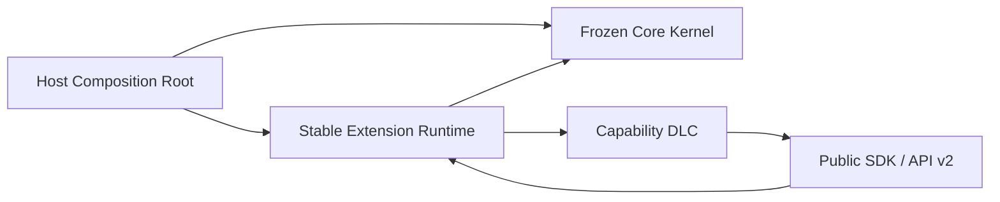

# DBFox Core Kernel 宪章

> 文档类型：架构合同
>
> 状态：已接受
>
> 最后核验：2026-08-31
>
> 适用范围：`engine/agent/`、`engine/tools/`、`engine/dlc/`、`dbfox_dlc_api.py`、`sdk/frontend/` 与所有 `dlcs/`

## 1. 决议

DBFox 从本合同生效之日起冻结 **Core Kernel 的职责和外部语义**。冻结不表示源码永远不能修改，也不表示 Agent 产品已经没有后续工作；它表示新能力默认进入 DLC，业务需求不能再顺手扩张 Kernel。

当前架构分为四个稳定层级：

| 层级 | 当前状态 | 所有权 | 允许包含 | 禁止包含 |
|---|---|---|---|---|
| Core Kernel | Frozen | Host | Session/Run/Turn、Loop、authority、Tool 生命周期、Approval、取消、事件、Artifact envelope、provider-neutral completion | SQL、文件、终端、故事、音乐、GitHub 等领域模型或分支 |
| Extension Runtime | Stable | Host | DLC 校验/装载/编译、贡献快照、资源与 Tool 调度、隔离执行、Host-owned UI slot | DLC 业务规则、跨 DLC 私有 service locator、第二套 Run Loop |
| Public SDK | Stable API v2 | Host | `dbfox_dlc_api`、`sdk/frontend`、manifest 与 Host 注入合同 | Engine/Renderer 私有对象、未声明的兼容行为 |
| Capability DLC | Evolvable | DLC owner | 文件/终端、SQL、故事、音乐、GitHub、可视化等能力和私有状态 | 修改 Kernel authority、绕过 Tool Runtime、直接依赖其他 DLC 私有实现 |

因此，“Core 是否足够完备”的准确答案是：**它已经足够承担当前通用 Runtime 和 Agent Loop，应冻结其职责；Extension Runtime 与 SDK 仍可按治理规则演进，但不能把领域能力吸回 Core。**

## 2. 依赖与运行方向



图中的 `Runtime → DLC` 表示签名包的验证、动态装载和调用，不是允许 Engine 源码静态导入 `dlcs.*`。静态依赖必须满足：

1. `engine/**` 不导入 `dlcs.*` 或 `dbfox_dlc_api`；
2. DLC 后端只通过 `dbfox_dlc_api` 使用 Host 合同，不导入 `engine.*` 或其他 `dlcs.*`；
3. DLC 前端只使用 `sdk/frontend` 声明和 `window.__DBFOX_EXTENSION_HOST__` 注入能力，不导入 `desktop/src`；
4. DLC 间协作通过用户意图、Artifact/Representation、冻结 ResourceRef 或显式 Composition DLC 完成，不共享私有 store/resolver；
5. `engine/runtime_composition.py` 是外层装配根，低层 Kernel 与 Runtime 模块不能反向依赖它。

这些规则由 `verification/tests/system/test_engineering_contracts.py` 的 AST/源码合同进入 CI，不依靠评审者记忆。

## 3. Frozen Kernel 不变量

下列语义被冻结，任何改变都必须先执行第 6 节的解冻流程：

1. **单一 Run Loop**：Agent 使用一个 provider-neutral 显式循环和原生 function calling，不增加领域 graph、第二调度器或 Thought/Action 文本解析器。
2. **冻结 authority**：SessionInput 保存不可变初始 admission fact；每个 ToolInvocation 在执行前由服务端校验当前 Project membership 与 canonical version，并持久冻结最小 ResourceRef。执行、审批与恢复只消费该 Invocation 权威；浏览 UI、DLC 内部状态或模型参数不能暗中扩大权限。Artifact 可继承显式同 Run `DERIVED_FROM` 的已证明公开成果来源，但来源继承不扩张 Invocation 或私有 Resource 权限。
3. **单一 Tool 生命周期**：Tool 经过注册、物化、Policy、Approval、执行、Observation、reconciliation；DLC 不建立旁路执行链。
4. **耐久事实优先**：Session、Run、Turn、Invocation、Event 和 Artifact 先持久化再投影；内存、SSE 和 UI Store 不是状态机权威。
5. **显式终止语义**：完成、失败、取消、等待批准、恢复和过期均由 Runtime 结算；provider finish reason 不是终态权威。
6. **非幂等不自动重放**：取消、断线、generation 变化或不确定结果后，不自动重复副作用。
7. **通用 Artifact envelope**：Core 保存 owner、type、schema version、relation、引用和有界元数据，不解释领域 payload。
8. **provider-neutral completion**：Core 只提供通用完成约束机制；事实一致性、作曲质量、SQL 充分性等规则由 DLC 注册。
9. **能力中立**：Kernel 的类型、提示、错误和控制流不出现具体 DLC ID、资源种类或业务术语分支。
10. **安全边界不夸大**：签名和 isolated worker 是可信发布者执行边界，不宣称为不可信代码的 OS sandbox。

## 4. 公开接入口

### 4.1 后端

DLC manifest 声明 backend entrypoint；Host 验证包、版本、权限与 digest 后动态载入，并把 `BackendExtensionHost` 交给入口注册贡献。作者只从 `dbfox_dlc_api` 导入合同。

`DLC_API_VERSION == "2"` 与 manifest 的 `extensionApiVersion` 使用同一个版本事实。公开符号集合冻结在 `verification/tests/system/fixtures/dlc_api_v2_surface.txt`。修改 `__all__` 必须显式更新该快照并说明兼容性，不能把 Engine 私有类型临时漏给 DLC。

### 4.2 前端

Host 拥有页面骨架、Workbench slot、Dock、错误隔离、激活/停用和 epoch fence。DLC 提供声明式 contribution 或由 Host 注入的窄能力，不拥有 App Shell，也不能直接访问 Renderer Store、API 私有 client 或 React 私有实例。

### 4.3 领域状态

DLC 的数据库、私有文件和外部资源由 DLC owner 维护。Core 只保存通用 identity、authority、Artifact 和运行记录；不得为了 UI 方便在 Core 或 Zustand 建立领域镜像。

## 5. 稳定级别

所有新合同必须归入以下一种级别，未标注时一律视为 Internal：

| 级别 | 含义 | 变更规则 |
|---|---|---|
| Frozen | Kernel 外部语义和第 3 节不变量 | 只能经正式解冻；行为保持的修复不改变合同 |
| Stable | Extension Runtime、API v2、manifest、SDK 已发布合同 | 保持兼容；新增也要更新快照、文档和 conformance 测试 |
| Experimental | 明确标注、未进入公开 `__all__`/稳定前端声明的试验入口 | 可演进，但不得被 System DLC 或第三方包当作稳定依赖 |
| Internal | 其他 Engine/Renderer 实现 | 可重构；DLC 不得导入或观察其细节 |

修复安全问题、正确性缺陷、性能问题或内部可维护性，不等于解冻，前提是外部语义和公开 API 不变并有回归证据。

## 6. 解冻规则

修改 Frozen Kernel 或 Stable 公共边界前，变更说明必须逐项回答：

1. 这是 Core 正确性/安全问题，还是至少两个独立 capability 都需要的真实通用变化轴？
2. 为什么现有 Tool、Operation、Context、Guidance、Completion、Artifact/Representation 或前端 contribution 不能表达？
3. 为什么问题不能在能力 owner 源头修复？
4. 新合同是否保持 capability-neutral、provider-neutral、owner-bound 和 fail-closed？
5. 是否新增 mapper、wrapper、fallback、双写或兼容层；若有，删除条件、负责人和使用量如何观测？
6. 对已安装 API v2 DLC、冻结 Run、持久化事实和前端 contribution 的兼容影响是什么？
7. 哪些合同测试、Core 测试、DLC conformance、composition 场景和迁移证明该变化正确？

只有以下情况允许改动公开边界：

- 不兼容修复必须提升 `extensionApiVersion`，提供明确迁移与旧版本退出策略；
- 向后兼容的新增可保留 API v2，但必须是可选、默认 fail-closed，旧 DLC conformance 继续通过，并更新公开表面快照；
- 临时兼容路径必须可观测、独立测试且有删除日期/条件，不能承载新的核心业务规则。

## 7. 变更落点判断

遇到新需求时按以下顺序判断：

1. 仅属于一个领域：放入该 DLC；
2. 需要调用文件、网络、进程、SQL 或模型：由 DLC 声明 Tool/Operation 和权限，Runtime 执行统一策略；
3. 多个 DLC 需要协作：先用 Artifact/Representation 和 Agent 编排；确有联合私有状态才设计显式 Composition DLC；
4. 现有 SDK 缺一个通用表达：先证明至少两个独立 capability 的共同需求，再走解冻规则；
5. 只有 Runtime 自身的正确性、安全、持久化或调度语义问题，才直接修改 Kernel。

“修改 Core 更方便”不是修改 Core 的理由。

## 8. 执行证据与维护

最低门禁：

```powershell
python -m pytest verification/tests/system/test_engineering_contracts.py -q
python -m pytest verification/tests/agent_core -q --tb=short -m "not e2e and not integration and not real_llm"
```

涉及具体 capability 时还必须运行对应 DLC 与 composition 测试；涉及前端 SDK/Host 时运行前端测试、类型检查和构建。架构导航、实现索引和 SDK 合同必须与源码同步。

本次冻结没有增加新 Runtime 依赖、兼容层、映射层或迁移债务。机器边界复用项目已有的 Python `ast` 工程合同，而不是引入新的依赖分析框架；当前规则只检查真实静态边界，不试图构造第二套模块系统。
