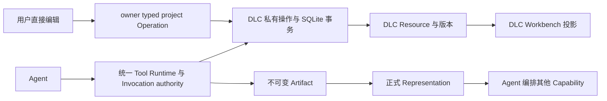

# Creative DLC 工程计划与系统地图

> 文档类型：工程计划与架构调查
>
> 状态：草案
>
> 最后核验：2026-09-05
>
> 适用范围：新增 Creative Capability DLC、组合验证与集成门禁

本计划把创作领域保留在独立 DLC 中。它不表示目录中的能力已经实现。
执行状态以 [机器可读队列](../../dlcs/program-status.json) 和每个 DLC 的
`program-status.json` 为准；只有完成验证与独立审查的能力才能进入集成候选。

## 1. 实施基线与分工

基线为 `2dc62653` 加任务启动时已有的工作区改动，其中包含 Story、Workspace、
Core Kernel 宪章和公开 API 合同。原有改动属于用户，不能作为本计划的实现提交。
Scene、Voxel、Shader、Pixel 分别使用 `creative/scene`、`creative/voxel`、
`creative/shader`、`creative/pixel` 分支与独立 worktree；它们具有相同的基线覆盖。

Director 负责调查、调度、共享文件、验证和集成。每个 Lead 负责本领域的完整交付，
并分别安排 Domain Architect、Backend、Workbench、Verification、Adversarial Reviewer。
当前环境同时最多运行四个 Agent，因此 Lead 与专员轮转执行；不将角色缺席当作通过。
Architecture Auditor 在一批候选完成后独立审查代码。

启动基线验证：Windows x64，工程合同 45 passed；Agent Core 219 passed、2 deselected。
这些结果只证明启动时基线，不证明新增 DLC 或最终整合已经通过。

## 2. 真实系统地图

| 边界 | 当前实现 | 新 DLC 的使用方式 |
| --- | --- | --- |
| 私有耐久状态 | `engine/dlc/api.py` 的 `DlcRuntimeInfo.data_path` | 在 owner data root 使用 SQLite；不加 Core 领域表 |
| 后端扩展入口 | `dbfox_dlc_api.py`、`BackendExtensionHost` | 注册 typed tools、operations、resources、context、guidance、artifacts |
| 精确执行权威 | `engine/dlc/compiler.py`、Resource Runtime v3 | Tool selector 选择 owner resource；Invocation admission 绑定当前项目归属和版本 |
| 人工短操作 | `DlcOperationSpec`、`engine/api/dlc_operations.py` | 项目校验后执行一次，同一个领域 store 负责 expected version / CAS |
| 显式 Workbench action | `DlcActionRunsHost` | 需要 Run、Tool policy 和 Artifact 结算时使用；不为每次拖动新建 Run |
| 内容输出 | `engine/representation.py`、Artifact 注册合同 | 小摘要进入 Observation；版本化导出/分页内容走 Representation |
| 视图与引用 | `sdk/frontend/index.d.ts` | Connector、Dock、Artifact View、onAsk reference；不保存第二份领域权威 |
| 前端停用 | `extensionLoader.ts` 的 epoch fence | Host 移除贡献；DLC 释放 WebGL、RAF、监听器和待完成请求 |

Resource 是作品或明确的创建集合；object、frame、layer、region 等是作品内对象。
Selection 与视图状态不产生权限。canonical document version 与 Resource authority fence
必须分别解释和验证，不能忽略其中任意一层。

## 3. 参考实现的复用决定

- 复用公开 SDK、SQLite 标准库事务、Pydantic 合同、Host 贡献和现有验证框架。
- Music 的 `BEGIN IMMEDIATE` 与 expected revision 检查可参考；其历史内容 hash 唯一索引
  会阻止恢复旧内容，不能复制为 undo。Undo 应提交新版本，允许恢复相同内容。
- Story 的章节更新/恢复展示了人机共用 store 与追加历史；世界事实的审阅状态和忽略
  frozen generation 的业务决定不进入其他创作领域。
- Workspace 的文件 SHA fence 属于外部文件边界，不用它代管其他 DLC 的私有数据库。
- Visualization 的 Artifact/Representation 和离线 vendor 构建可参考，但其一次创建式
  Artifact 模型不能代替增量编辑的耐久作品。
- 现有 Music 将整份文档序列化再截断 context 的方式不适合大型创作；新能力须在数据检索层
  给出有界摘要、分页、选区或层级检索。
- 渲染器和编辑器先调查官方成熟实现，再在 DLC 包边界集成；不从 Renderer 私有目录导入。

没有因为领域都包含层、画布、时间线或历史而新增共享 Core 抽象。
至少四个可工作的 DLC 形成证据后，再由独立 Pattern Auditor 区分偶然相似、DLC-local
复用库、稳定 Host seam 与 Core primitive，默认保留在领域侧。

## 4. 已确认的平台限制

1. 公开 API 没有项目删除回调。DLC 必须明确作品删除与私有数据保留政策；不能声称 Core
   删除项目会自动级联清理私有 SQLite。确需增加钩子时必须另行走通用 seam 审议。
2. Tool `required_resources` 只允许本 owner namespace。跨 DLC 联合私有 Resource 的
   dependency contract 尚未实现。首批组合优先普通 Agent 编排正式 Artifact/Representation。
3. Tool 侧 Representation 读取目前是 JSON；Frontend Artifact View 提供 Blob stream。
   跨 DLC 消费需要有界的 JSON manifest/分页数据，不能假设能访问其他 DLC 的磁盘文件。
4. Project Operation 没有完整 Tool 取消/重放语义。取消 HTTP 读取不证明已开始的事务回滚。
   人工编辑使用短事务，结果不确定时重新读取；不自动重放写入。长操作走 Tool Runtime。
5. Operation 默认输出上限 1 MiB、平台最大 10 MiB；Representation JSON/stream 分别有
   8/64 MiB 上限。Context fragment 最多 4,000 字符、每 contributor 最多八个。
   领域合同应设置更小且经过测量的预算。
6. DLC 不能打包原生 Python 扩展或运行时 pip。CAD 等领域必须先验证成熟内核在现有部署
   边界下的可行性，不能把开发机安装的软件当成可发布依赖。

相关权威合同：[Core Kernel 宪章](core-kernel-constitution.md)、
[Core/Capability 合同](agent-core-capability-dlc-contract.md)、
[Runtime DLC 平台](runtime-dlc-platform.md)。

已依据真实Scene/Voxel需求单独审议并实现[工作台工件导航](dlc-artifact-navigation.md)，
保留公开API v2可选成员和原Artifact投影；Scene独立真实Electron与Voxel实际导航/历史下载已有证据，Voxel完整门禁仍在执行。Loader迟到注册和
[折叠Tree挂载](../quality/host-tree-visible-subtree.md)属于既有Host正确性修复，未增加领域
原语。Scene/Voxel同Run增量验证另揭示Artifact结算仍检查最初Run输入而非持久Invocation；
该通用修复已在根开发分支通过Core/System回归及独立Scene对抗审查，支持同Run显式DERIVED_FROM公开成果继承，不能据此给私有Resource增加权限。Context三处结构化投影复用正式availability，Artifact按钮只发既有artifactId。最终状态与提交见机器队列。

## 5. 波次与依赖

| 波次 | 能力 | 进入条件 |
| --- | --- | --- |
| 1A | Scene、Voxel、Shader、Pixel | 独立架构和官方方案调查完成 |
| 1B | Game、Comic、CAD、Animation | 1A 出现经过完整门禁的稳定结果 |
| 首批组合 | Pixel→Game、Scene→Animation、Scene→Game、Story→Comic | 参与能力通过集成门禁；先判断普通 Agent 编排是否足够 |
| 2 | Map、Architecture、Poster、Typography、Sound、Simulation、Robot、Electronics、Lego、Creature、Recipe、Fashion | Wave 1 达到稳定集成门禁 |
| 后续组合 | Music→Visual/Game、Map→Story、CAD→Scene 等 | 真实用户任务与正式交换合同已存在 |

Composition DLC 只有在普通 Agent 编排无法表达且确有自有联合状态时才创建。
不为能力数量创建空包，也不为绕过 foreign-resource 限制创建私有导入。

## 6. 验证与集成门禁

每个 Lead 必须交付可编辑 Workbench、后端、增量 Tools、持久化、Artifact/Representation、
例子、可执行 capability benchmark、架构说明与独立红队结论。
基线之外的源码改变必须具有实际测试证据；没有证据的项目保持未完成。

Creative benchmark 复用 `verification/bench/framework` 的 Manifest、TrialOutcome、统计与报告，
领域 scorer 留在 capability/composition suite 中。Agent trial 使用生产 RunLoop，scripted provider
只控制外部刺激，不复制 Runtime。确定性通过不等同于真实模型已理解自然语言。

至少测量创建正确性、增量修改、非目标内容保留、用户编辑保留、工具效率、恢复、stale 拒绝、
跨 DLC 交换、Artifact 正确性和 context 上限。Regeneration abuse 用稳定对象 ID 和非目标内容
前后比较检测，不能只看最终渲染结果。每领域包含十次以上混合修改及大型文档案例。

集成前审查：wrong project/resource、删除后引用、并发 CAS、损坏数据、未知 schema、
事务中断、重复 invocation、不确定写入、停用后回调、输出超限、外部资源与 Core 泄漏。
Director 收到验证报告后才可标记 `integration_candidate`；跨 DLC 验证与独立架构审查后
才可标记 `integrated`。原有用户改动始终单独保留。
