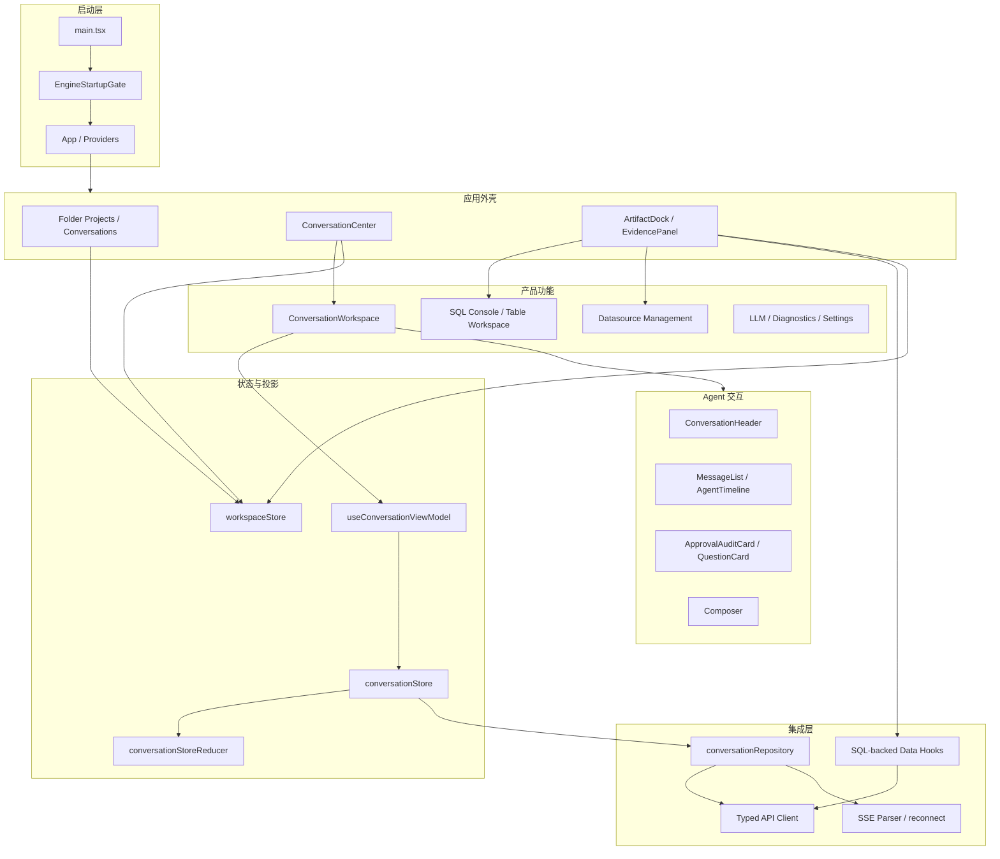
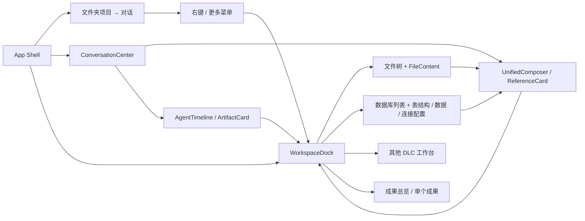
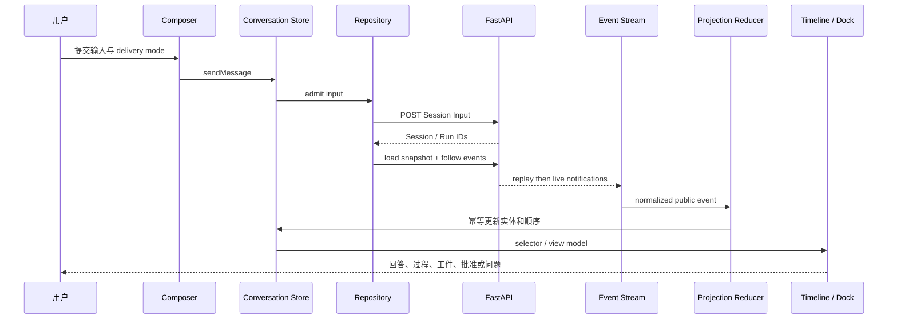
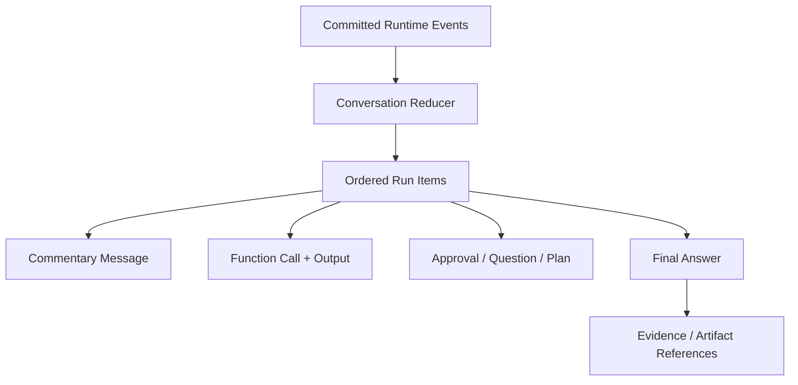
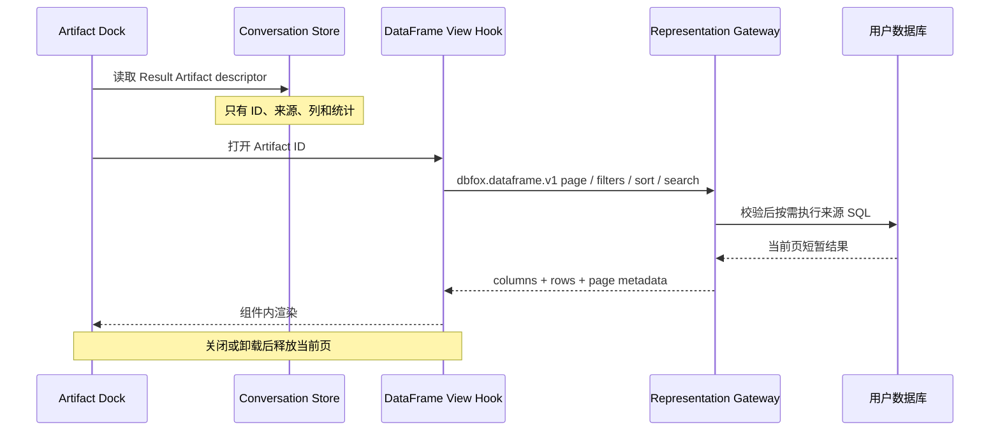

# DBFox 前端架构

> 文档类型：架构说明
>
> 状态：当前
>
> 最后核验：2026-11-08
>
> 适用范围：`desktop/src/` 的工作区、传输、状态和用户交互
>
> 权威边界：[Agent Core 与 Capability DLC 架构合同](./agent-core-capability-dlc-contract.md)。已完成的 Shell 迁移方案保存在 [`docs/archive/designs/`](../archive/designs/)；当前代码、测试和本文是 Workbench 事实源。

## 1. 设计目标

前端是 Agent 公共事实的产品投影，而不是第二套 Runtime。它负责工作区导航、流式呈现、人机中断交互、工件浏览和当前页查询结果，但不自行决定 Run、Approval、Evidence 或 Artifact 的权威状态。

## 2. 分层架构

## 3. 工作区组件关系

布局与交互合同：

- 左侧只展示文件夹项目与所属对话（默认预览 5 条，支持显示更多）。项目行有展开箭头、文件夹图标和始终可发现的更多按钮；右键和更多菜单提供相同的能力入口。DLC 不再常驻左侧资源分组，旧 `ResourceViewContainer` 已删除。
- “打开文件夹”使用 Host native picker 返回的 canonical root；项目默认显示文件夹名。先核对已有 Workspace binding，再以 canonical path 的 SHA-256 派生 opaque Project idempotency key，重新打开同一文件夹复用项目与对话。Project API 仍不保存路径；绑定通过原有 `dbfox.workspace` operations 创建，失败后由用户显式重试并先核实 binding，不自动重放写入。
- 同名文件夹可位于不同路径。迁移 `f8a9b0c1d2ee` 仅移除 Project name 唯一约束，保持 Project / Conversation ID；降级遇到同名项目会拒绝执行，要求先人工改名，不删除数据。旧的未绑定项目继续可见，可在文件工作台关联目录。
- 中间承担对话。`ReferenceCard` 在已发送消息、输入框、数据引用面板中使用相同的图标、名称、类型说明和操作区域；移除引用不触发打开，也不把输入焦点交给外层容器。添加附件时保留输入与按钮忙碌反馈，移除“正在添加文件…”文字；发送在处理完成前禁用。
- 右侧是通用工作区。项目菜单通过 Connector `onOpen` 或 Host 的 `core.project-workbench` 打开已注册视图；领域数据与行为始终由 DLC 所有。数据库列表、表结构、数据样例和连接配置位于同一 Dock，连接配置采用内嵌表单。文件工作台展示按需加载的树及内容；两种导航器均可收起。
- 同一 viewer 的新预览替换旧的未固定预览；双击标签或点击固定按钮保留标签。已固定标签、其他 viewer 以及其他会话 scope 不受替换影响。Tab overflow、键盘焦点、全屏与折叠沿用原 Dock 实现。
- `openWorkbenchReference` 通过 viewer 声明的 `objectKinds` 定位对象视图；必须唯一匹配，且 SDK admission 检查类型属于 owner namespace。精确 object/version、authority、locator 和会话 scope 决定标签身份。附件与成果沿用各自已有导航和校验链。查看或展开不会增加 Agent authority；“加入对话”才交付 typed reference，由后端 admission 校验。
- `workspaceStore.mainSurfaceByProject` 是当前项目/会话选择的唯一事实源；Store 只保存 scope、Tab 身份、布局和待发送引用。文件正文、目录数据、连接配置与表内容留在 owner 组件和 DLC 内，Core 不复制业务资源模型。

### 3.1 设计系统与复用决策

全局复用 `styles/tokens.css` 的颜色、字体、密度、阴影与圆角。默认界面正文/控件为 15px、说明为 13px、对话正文为 16px；代码与表格仍为独立可调的 14px 基线。功能图标主要为 20px，紧凑动作 16/18px，标题可用 22px，窗口控件保留原生比例。合法的已保存字号保持原值。三栏以低对比实色表面和细分隔线组织，浮层统一使用轻微透明与分层阴影；减少透明度、高对比度使用实色，减少动效遵从共享令牌。

窗口 chrome 融入工作区：左侧导航从窗口顶部开始，品牌与收起按钮占同一个 48px 首行；右侧 `TitleBar` 位于实际可调整宽度的 workspace 内，以同色背景承载当前对话标题和窗口控制。首页不重复品牌，主题选择沿用“设置 → 外观”。删除原独立 `ConversationHeader` 及其失效样式，标题直接投影 `mainSurfaceByProject` 选定的 Conversation，不新增标题 Store。窗口拖动、最大化与关闭复用已有 Electron IPC；拖动区与按钮 `no-drag` 按 [Electron 官方规则](https://www.electronjs.org/docs/latest/tutorial/custom-window-interactions)区分，控制按钮的双击不会冒泡触发最大化。默认 UI 栈优先本机 Segoe UI Variable Text，保留离线中文 fallback 和用户字体偏好；没有新增字体下载、组件库或窗口控制层。

浅色主题的中性底色统一提亮：默认侧栏 `#F7F8FA`、辅助面 `#FAFBFC`、工作区白色；悬停、按下、分隔线和三种 neutral tone 同步使用更轻的灰阶。文字颜色与深色主题色阶保持原值，Tab 分组背景使用 subtle 而非 pressed 角色。

- 导航继续使用现有 [shadcn Sidebar](https://ui.shadcn.com/docs/components/sidebar) anatomy、Radix menu/tab；功能图形改用固定提交的 [Phosphor](https://github.com/phosphor-icons/core) 官方 SVG，不另加 UI 框架。
- 文件身份优先采用微软官方 [Fluent 文件图标](https://github.com/microsoft/fluentui-system-icons/tree/9eb184e96268d3293462f9d9d19225b4c7b07774/packages/react-icons-file-type)，固定 CDN 版本 `fabric-cdn-prod_20261014.001` 的 18 个原始 SVG，按原生 16/20px 分别用于树与引用卡片。Markdown 用已有 Simple Icons 的标准标志（CC0），21 个代码语言标志沿用 [VS Code Icons](https://github.com/vscode-icons/vscode-icons) 的原始素材（MIT，固定 `f0a0c40aeae5eba2917ada14ad59b7e7f729e396`）。通用于树、消息引用、输入框与 Dock；CSV 使用中性表格符号，显式文件夹/数据表语义优先于同名扩展名。来源、SHA-256 与许可说明随安装包置于 `licenses/`，素材从本地加载，不增加 npm 依赖或远程请求。未采用整套图标主题运行时，也不自绘品牌标志。
- 操作图标从 `components/icons` 的原生 SVG sprite 渲染；DLC 通过 `host.ui.Icon` 使用同一批图形。构建验证固定提交、原始资产 SHA-256 和生成文件，安装包携带 MIT 声明；没有图标字体、远程加载或图标框架 runtime。对象图标使用 duotone、选中状态可用 fill，普通动作使用 regular。播放/暂停、停止、循环、刷新、增删、章节排序、游戏、数据表与提示使用明确的语义图形及可访问名称；不传递状态或领域数据，不增加兼容层。
- 统一输入框采用无常驻底色、边框或阴影的加号，保留悬停和键盘焦点反馈；发送/停止共用圆形主按钮，向上箭头代表发送、方形代表停止。按钮随现有密度变化，不改变上传期间的输入能力、发送保护、IME 或 Enter/Shift+Enter 合同。
- 树继续使用现有 [Zag Tree View](https://zagjs.com/components/react/tree-view) 与 TanStack Virtual。默认展开的 lazy ancestors 通过官方 `api.expand()` 逐级加载，I/O、取消和错误仍归原树状态机。
- 只读代码以现有 CodeMirror / Lezer 加官方 [`@codemirror/language-data`](https://codemirror.net/docs/ref/#language-data) 6.5.2（MIT）提供语法树和高亮；语言包按需加载，Host `FileContent` 自身也 lazy import。不引入完整 Monaco 编辑器，不手写语法解析器；语言包无法加载时仍展示可读源码。新增成本是语言 chunks 与依赖维护，受锁文件、许可证治理和生产 bundle 预算检查约束。
- Markdown 复用现有 sanitized `MarkdownContent`，默认渲染，可切换源码或分栏；窄 Dock 上分栏纵向排列。HTML 代码按文本呈现，不执行。此组件只读，未实现代码编辑/保存。
- 当前文件树读取沿用 Workspace 的有界 UTF-8 operation；二进制、非 UTF-8 和过大文件保留明确错误。Excel 附件仍由 Data 已有 workbook viewer 处理，未另建跨 DLC 文件解析链；统一图标不表示所有文件类型已能预览。

这些增量扩展 Host UI 与注册合同，不引入兼容 mapper、镜像资源 Store、第二套权限或 SQL 执行链。源码与验证索引见 [implementation-map](./implementation-map.md#42-app-shell-与-workspace)。

## 4. 会话数据流

恢复顺序固定为：

1. 加载 Conversation Snapshot；
2. 从 snapshot cursor 重放已提交事件；
3. 切换到 live 通知；
4. 发现 sequence gap 时放弃局部猜测，重新加载 snapshot。

## 5. Responses Items 与过程呈现

设计约束：

- Agent Timeline 按服务端 sequence 展示 commentary、工具调用、工具结果、Plan、Approval、Question 和 final answer，不展示私有 chain-of-thought。
- live Item 与 snapshot Item 使用稳定 ID 和 revision，刷新后不得生成重复步骤。
- Approval/Question 在待处理时固定靠近 Composer；处理后成为只读历史部分。
- Answer 使用增量合并和平滑显示；终态消息以持久投影为准。
- Citation 由 Markdown AST 插件解析为句内 Evidence 按钮，不依赖字符串后处理。
- Markdown 不解析通用 raw HTML；GFM、Citation 和安全换行都在 AST 层处理，最终仍经过 sanitize。
- Live delta 使用稳定的 `item_id + revision + offset` 追加到已开始的 RunItem；断线后以 snapshot 的完整持久内容为准，再从 durable event cursor 继续，避免首段缺失或重复。

## 6. Artifact Dock 与 DataFrame Representation

DataFrame Representation 的页面响应同时携带 `originalObservedAt` 与 `readAt`。UI 必须并列显示“分析取数”和“当前重查”，并说明普通 Result 表格不是历史快照；Evidence 的 `observedAt` 仍代表回答当时的最小事实。

禁止进入 Conversation Store、localStorage、IndexedDB 或 SSE Artifact 事件的字段：

- `rows`
- `previewRows`
- Visualization 引用来源时复制的 rows/series
- 任意结果单元格副本

### 6.1 数据单元格展示合同

表数据预览与 Result Artifact 复用 `CellValuePreview` 作为只读值展示入口。它只负责把当前页已有值投影为适合网格阅读的形式，不改变数据库值、不回写数据，也不建立第二份结果缓存。完整交互、分类和验收规范见[数据网格与值查看规范](../specs/data-grid.md)。

| 值类型 | 网格表现 | 按需查看 | 安全边界 |
|---|---|---|---|
| `NULL`、布尔、数字、日期 | 固定的紧凑语义样式 | 不额外加载 | 保留原始复制文本 |
| JSON 对象或数组 | 类型与成员数摘要 | 结构树和格式化详情 | 只解析合法对象或数组；无效 JSON 按普通文本显示 |
| 长文本或多行文本 | 类型标签与单行截断摘要 | 有界悬浮预览；点击打开完整 Value Viewer | 保留原始换行；网格不展开整段内容 |
| 普通 HTTPS URL | 省略显示并带外部链接图标 | 点击先进入 Value Viewer，再由明确动作交给 Electron shell boundary | 只允许 HTTPS；前后端边界重复校验 |
| HTTPS 图片 URL | 图片类型入口，不自动请求远端 | 稳定悬浮约 400ms 后快速预览；点击在应用内完整查看；可再次选择外部打开 | 仅识别受支持图片后缀或已知图片处理参数；使用 `no-referrer`；失败显示固定状态 |
| 二进制 | 仅在二进制列中识别后端 `<binary>` 占位 | Viewer 解释原始字节未进入当前合同 | 不把普通字符串 `<binary>` 当占位，不伪造预览或下载 |

图片预览只放宽 CSP 的 `img-src` 到 HTTPS，不放宽 `connect-src`，也不经过临时文件、下载目录或自建图片代理。数据库中的 URL 只有在稳定悬浮意图成立或用户点击后才创建 ``；掠过单元格或在延迟内移开不会请求远端。固定尺寸悬浮框只约束布局，不承诺减少下载量：没有服务端缩略图合同时，浏览器仍会请求原始图片。`file:`、`javascript:`、HTTP 和其他协议不可点击、不可加载。

该设计沿用 DataGrip/DBeaver 的“紧凑网格 + 按需 Value Viewer”边界：复杂值详情不占用行高，完整内容只在用户选择单元格后出现。当前实现保持只读，不引入它们的单元格编辑、LOB 下载或二进制编辑能力。

设计依据：

- [DataGrip：View data](https://www.jetbrains.com/help/datagrip/tables-view-data.html) 将 JSON、数组、长值和图片放入独立 Value editor，而不是扩大主网格行高；
- [DBeaver：Value Panel](https://dbeaver.com/docs/team-edition/desktop/Value-Panel/) 按 Text、JSON、Binary、Image 等内容类型提供专用查看方式；
- Electron app protocol 的 CSP 只开放应用确实需要的资源来源，因此图片只扩展 `img-src`，不扩展脚本、frame 或通用网络请求能力。

## 7. 状态边界

| 状态类型 | 所有者 | 示例 |
|---|---|---|
| 导航状态 | `workspaceStore` | `activeProjectId`、唯一的 per-project `mainSurfaceByProject`、Conversation/draft Workbench scope、右栏 Dock 开合与 Tab identity；真实 Project list/create 由 `projectsApi` / `useProjectState` 投影 |
| 未发送草稿 | 同一 `workspaceStore` Workbench | 新任务按项目、已有对话按 Conversation identity 保留输入；仅内存，不写入布局持久化。发送完成只清理原 Workbench 中仍与提交内容相同的草稿及引用，不清理后续输入或新项目 |
| 本机外观偏好 | `ThemeProvider` + localStorage | 主题模式、受控色板、分区字号 |
| 数据源状态 | `dbfox.data` 前端扩展自持 | 连接分组、目录与刷新状态由 DLC 前端自持，不进入 Core store |
| 会话公共投影 | `conversationStore` | Run、Run Item、Artifact、Approval、Question、Plan |
| 组合视图 | `useConversationViewModel` | 当前 Run、排序后的消息和工件 |
| 当前页面数据 | Renderer 组件/DataFrame hook | Result 当前页、Visualization 当前读取页与 Vega View；关闭或卸载即释放 |
| 服务端事实 | FastAPI + 元数据库 | Run 状态、Approval、Artifact 关系、Event sequence |

对话导航由 `/conversations` 在分页前过滤纯工作台操作的终态 Session；沿用 Run 的持久 `request_json.source` 区分来源，不按标题或具体 DLC 名称判断。无 Run 的新对话、存在真实对话输入的 Session，以及仍在运行、排队或等待介入的操作继续显示。被过滤的工作台历史仍可通过原 Session、Run 和项目 Artifact 入口读取，没有删除记录或增加第二种 Session 模型。

## 8. 扩展边界

- Scene 导出工件的三维预览属于 Scene DLC，只在 workspace surface 启动 GPU 视口。它通过公开 Representation 的 `objects_page` / `materials_page` / `geometry_catalog` 复用同一分页读取，逐页核对 Artifact 的版本、hash 和 `durable_snapshot`；不读取管理接口的当前 head。只读视口保留镜头、轨道观察与显式补光选项，禁止选取编辑、变换和删除，并在隐藏、关闭或失活时释放 Three 资源。
- Scene / Animation 从作品库新建、选择作品时，直接打开包含规范 object/authority 的具名 Dock target，不把当前作品身份只留在库组件内。Animation 保存后的同一文档刷新保留内容组件，等待读回期间锁住编辑；读回失败才撤下失效内容。服务端版本仍是唯一事实源，没有乐观提交或第二份文档状态。

- 新工作区类型通过 `WorkspaceDock` 的 Tab kind 与贡献注册，不向 App 添加业务分支。当前 presentation/visibility/render 收敛到 `features/dock/dockViewComposition.ts` + `dockViewContent.tsx`；`WorkspaceDock` 只按 contribution 渲染，unknown view 走元数据 fallback。
- 新 Artifact 类型通过统一 Artifact model、renderer 和 dock projection 扩展。
- 新公共事件先定义后端契约和 reducer，再增加视图；视图不得解析原始调试事件。
- 新流式 channel 必须定义去重身份、持久化替代物和断流恢复语义。
- 通用视觉能力进入 `components/ui` 或 `components/settings`，业务状态留在 feature 内。
- Package-free DLC 只能通过版本化 `FrontendExtensionHost.ui` 复用 Host presentation primitive。当前 `ui@1.0.0`
  暴露 Zag-backed `Tree<T>`：DLC 传原始对象及 id/label/children accessor，Host 提供 keyboard、focus、
  selection、expansion、async child/loading/error 和 token CSS；action/footer render slot 只呈现 DLC 已有动作，
  不代理执行。不得把它扩成 UniversalResource DTO、资源 store 或动作代理。
- Frontend contribution ID 必须等于 DLC owner ID 或使用 `owner_id.*` 命名空间；Core 的 Dock/Artifact View ID 在 admission 前预留。重复、本地重注册和越权命名均使该 DLC 的整批贡献失败关闭。
- Activation projection 以单调 epoch/generation 提交；旧 fetch 或动态 import 完成后不得覆盖新 snapshot。DLC 可实现 `deactivate()` 清理 listener、缓存、样式和重资源，Host 同步移除失去 owner 的 Dock Tab。

## 9. 视觉系统与交互语义

前端以 Apple HIG 的内容层与功能层、渐进展开和原位反馈为设计基础；`tokens.css` 统一表达 background、panel、border、text、focus、brand 和 status。字体优先使用所在平台的本机界面字体，并补离线 CJK fallback。warning/success/danger 只表达状态，不再为单个功能自行创造色板或字体系统。

交互状态必须一致：

- 主操作、选中 Tab、focus ring 使用品牌语义；
- warning/success 不能同时出现在同一操作的最终状态；
- disabled 必须说明原因，不能只有低透明度；
- loading 使用产品动作描述，不暴露内部健康检查或技术码；
- 点击区域至少 28–32px，辅助文字不低于 12px。

### 9.1 外观偏好合同

外观设置由 `ThemeProvider` 作为进程内唯一权威，版本化偏好只保存在本机
`dbfox-appearance-v1`。它不进入数据库、会话、诊断包或模型上下文。启动时只对旧的
`dbfox-theme` 明暗值执行一次单向迁移，不保留新旧双写。

- 主题模式为 `system | light | dark`；`system` 通过 React 外部状态订阅跟随操作系统。
- 强调色和中性色来自经过浅色/深色校准的封闭枚举；不接受任意 CSS 或十六进制输入，避免破坏对比度、状态色和焦点环。
- 字号按 UI、数据表、SQL/代码、Agent 对话四个真实阅读场景独立设置，使用受控整数 px：UI 11–16、数据 10–18、代码 11–22、Agent 13–24；组件继续引用语义字号 Token，不保存逐组件覆盖。
- 密度使用 `compact | standard | comfortable` 统一控制工具栏、按钮和主要留白；UI、数据、代码字体家族分别选择受控的本机字体栈。
- Agent 与 SQL/代码行高独立；数据表可配置默认行高、网格线、斑马纹、NULL 呈现和默认主键冻结，不改变手动列固定能力。
- 高对比度、减少动效同时支持显式设置和系统媒体查询；系统 DPI 交给 Electron Chromium，不叠加 CSS zoom。
- 数据源侧栏与 Agent 工件面板把拖拽结果写回同一偏好文档；原生窗口位置与尺寸由官方 Window State 插件独占，不保存第二份窗口坐标。
- 导入/导出使用同一严格 schema，拒绝未知字段与超大文件；结构上不包含 Token、密码、DSN、SQL、会话或日志。
- `ThemeProvider` 只把规范偏好投影为根元素的 `data-*` 属性；`tokens.css` 是色彩和字号的唯一视觉事实来源。
- 设置即时预览并自动保存；重置恢复系统主题、紫色强调、冷灰中性色和标准字号。
- Visualization DLC 的 Vega renderer 在渲染时读取同一组语义 CSS Token，不维护第二份图表主题配置。

这个边界参考成熟桌面工具的“用户设置 + 即时预览”模式和主题系统的受控参数设计，
没有引入新的主题库、任意颜色解析器、兼容 mapper 或组件级持久化。

## 10. 可访问性

Radix 负责 Dialog、Tabs、Collapsible 等焦点管理。自定义列表、Activity、Artifact 和数据表必须提供 role、accessible name、键盘操作和清晰 focus。动画尊重 `prefers-reduced-motion`。

Approval/Question 属于阻塞性交互：待处理卡靠近 Composer，并且屏幕阅读器能获知风险、状态和可执行动作；处理后变为只读历史，不从 DOM 无痕消失。

## 11. 性能策略

- 长对话超过阈值后使用 TanStack Virtual；
- 动态虚拟位置写入 nonce CSSOM，不违反 CSP；
- SSE event 先批处理再进入 reducer，避免 token 级全树重渲染；
- streaming text 使用平滑展示，但 committed Message 到达后立即归并；
- DLC Artifact renderer 和其 vendored 重型运行时随 DLC 延迟加载，不进入 Core 初始 bundle；
- Result 新请求取消旧请求，过期 response 通过 sequence 丢弃；
- bundle budget 分别约束 initial entry 和 deferred chart chunk。

## 12. 错误、取消与恢复

API error 先映射为用户可理解文案，技术 detail 留在诊断。EngineStartupGate 区分 starting/ready/failed/stopped，失败提供重试和诊断入口。

组件卸载、来源变化和用户取消会传播 AbortSignal。AbortError 不显示为业务失败。SSE 关闭不等于 Run 失败，UI 会重载 snapshot 或继续跟随；只有 committed terminal state 能显示最终完成/失败/取消。

收到 committed `run.cancelled` 后，Reducer 将该 Run 尚未结算的 pending/running/waiting Activity 统一投影为 cancelled，并保留已产生的回答草稿、步骤和 Artifact。取消不是失败，也不删除已有产品成果。

## 13. 测试策略

前端测试分为：

- reducer/event contract：去重、gap、correlation、Plan、Approval、Question、Artifact；
- product interaction：Composer、Agent Timeline、Question、Artifact Dock、DataFrame table；
- accessibility：焦点、role、label、键盘、reduced motion；
- security：CSP、sanitize、外部导航、secret-safe error；
- engineering：TypeScript、ESLint、production build、bundle budget。

具体通过数量会随测试增长而变化，不在架构事实文档中固化。当前结果以绑定 commit 的 CI
记录为准；权威命令和门禁范围见[工程质量门禁](../quality/engineering-gates.md)。

## 14. 关键文件

| 领域 | 文件 |
|---|---|
| 启动 | `desktop/src/components/EngineStartupGate.tsx` |
| Workspace Shell | `desktop/src/stores/workspaceStore.ts`、`desktop/src/features/appShell/WorkspaceDock.tsx` |
| 共享资源呈现 | `desktop/src/components/resources/ReferenceCard.tsx`、`resourcePresentation.tsx`、`FileContent.tsx` |
| Dock Composition | `desktop/src/features/dock/dockViewComposition.ts`、`dockViewContent.tsx` |
| Workspace presentation shell | `desktop/src/features/workspace/WorkspaceShell.tsx` |
| Core 导航与 Project Context | `desktop/src/features/resources/ProjectResourceSidebar.tsx`、`desktop/src/features/projects/ProjectOverview.tsx` |
| 打开文件夹/本地文件边界 | `desktop/src/features/projects/ProjectCreateForm.tsx`、`desktop/src/lib/projectFolder.ts`、`desktop/src/lib/desktopHost.ts`、`desktop/main/index.ts` |
| Data Dock 内连接、资源树与 SQL/Table View | `dlcs/dbfox_data/frontend/index.js` |
| Workspace 文件 Connector、Dock 与 Artifact View | `dlcs/dbfox.workspace/frontend/index.js` |
| Conversation | `desktop/src/features/conversation/workspace/ConversationWorkspace.tsx` |
| Reducer | `desktop/src/stores/conversationStoreReducer.ts` |
| Stream | `desktop/src/features/conversation/conversationStreamRuntime.ts`、`conversationRepository.ts` |
| Timeline | `desktop/src/features/conversation/workspace/MessageList.tsx`、`AgentTimeline.tsx` |
| Artifact Dock | `desktop/src/features/conversation/workspace/ArtifactDock.tsx` |
| Result/DataFrame state | `desktop/src/features/workspace/dataFrame/useDataFrameView.ts` |
| Artifact embed 与多视图 | `desktop/src/features/workspace/queryResult/remarkDbfoxCitations.ts`、`desktop/src/features/workspace/artifacts/ArtifactViewHost.tsx` |
| Tokens | `desktop/src/styles/tokens.css` |
| Appearance contract | `desktop/src/lib/appearance.ts`、`desktop/src/hooks/useTheme.tsx` |
| Appearance settings | `desktop/src/features/settings/AppearanceSettingsPanel.tsx` |

## 工作区实际宽度与收起

`ConversationWorkspaceLayout` 在 Host 的真实 stage 边界测量可用宽度。低于 868px（对话 520 + 分隔条 8 + Dock 340）时，打开的 Dock 独占 stage，隐藏的对话保持挂载并设置 `inert`/`aria-hidden`；紧凑 Dock 的返回箭头收起面板并恢复输入焦点。收起 Dock 后显示对话和 44px 工作区入口。窗口或导航宽度恢复后自动重新分栏，同一个组件树不因布局模式切换而卸载。

宽屏分隔条复用 `react-resizable-panels` 的指针和键盘交互，Dock 在 340px 最小宽度停住。收起只由已有 Host 工作区按钮更新 `workspaceStore`，不再让 Panel 自行 collapse 后留下仍为 open 的 store。新工作台默认关闭 Dock，只有显式打开或恢复该工作台之前已展开的状态时展开。实际 Electron 作者矩阵见 [工作区布局验证](../quality/workspace-compact-layout-verification.md)。

### 工作区连续性与界面层级

- 左侧统一为文件夹项目与对话，只有一个“新任务”入口。项目折叠行使用 `aria-current="location"` 表示当前文件夹，对话/新任务使用完整的中性圆角选中表面；不叠加蓝色竖边。项目能力继续由已有菜单进入。
- 首页只保留任务标题和输入区，删除“最近工作”、重复说明与长占位文案。历史保留在左侧与命令搜索。对话阅读栏最大 820px；Composer 的通用操作使用图标与悬停提示，模型、执行方式和错误仍保留必要文字。
- 线程信标来自服务端状态。既有 `/conversations` 读投影返回 `run_status` 和耐久会话 `cursor`；有未结束 Run 时取最早的一轮，否则取最新结束的一轮，排队输入不能盖住待审批状态。导航按同一个 cursor 比较列表与快照/SSE 的新旧，较旧缓存不能覆盖新事实。初始加载、窗口恢复焦点及 Engine generation 变化复用已有列表读取，不新增状态机或轮询通道。
- 工具记录默认折叠，只在展开后挂载参数和结果；用户明确展开的记录不因从运行转为结束而收回。
- `ComposerContext` 显示当前项目和模型。项目选择直接更新 Shell；模型列表按需使用现有 models API，选择只修改已有安全配置元数据。`useSavedApiConfig` 通过浏览器事件订阅同一配置源，不建立第二份配置 Store，不读取或复制 API Key。
- 对话名在创建时从首个有效句子截短，按 grapheme 保留完整字符；完整提问仍保存为消息。已有长标题只在导航显示时截短。重命名复用已有 PATCH 合同，仅更新标题，不覆盖正在变化的 Run/History 投影。
- `workspacePersistence.ts` 复用现有 Zustand persist 与 Zod，仅保存项目、对话、Dock Tab 身份、开合、手动宽度和导航折叠偏好。最多 40 个项目/工作区、每个 12 个 Tab，优先保留当前项。恢复后由原资源 owner 重新读取内容；不保存消息、SQL、Artifact payload、输入草稿、References、授权租约或执行状态，也不自动发送或重放任务。
- `DockViewContribution.preferredWidth` 是可选的展示建议（320–1200 CSS px），由 Host 在真实布局边界解析并夹到可用空间；手动宽度优先。数据库表、SQL、Excel 和文件分别声明适合的默认宽度。Data DLC 自己贡献数据库浏览器，避免 Core Connector frame 的重复标题；低于 520px 切换列表/详情单栏。
- 引用和成果卡复用 `ResourceIcon`、`ReferenceCard` 与现有 Artifact 身份。表格等预览按需挂载；图表、图片、音频默认展示已有 Renderer。点击继续进入同一个 Dock Tab，不建立 payload 镜像。
- 外观设置复用 HIG 启发的角色语义、本机字体、共享功能图标和标准文件图标，常用选项在前，高级选项折叠。即时预览由真实展示组件组成并设置 inert，预览不创建任务。加载时保留窗口控件和输入区，读取失败在对应区域重试。2026-11-07 的比例、材质、图形与验证见[Apple HIG 工作台设计](../quality/apple-hig-workbench-20261107.md)。

导航、设置、Dock 标签、文件模式和资源树使用共享选中表面、细边、高光与短过渡。长期内容区保持稳定的雾面底色，临时菜单采用轻透材质；增强对比度或减少透明度使用实色。文件引用按规范 Artifact 的真实类型选择标志，不复制领域 payload，也不根据显示名称改写资源身份。

持久布局是可丢弃的 UI 偏好，耐久任务事实仍来自 SQLite/API/SSE。本次仅补全既有列表读投影，不改变 Kernel 状态机、不增加运行时依赖、迁移双写或兼容层。最新设计与验证见[Apple HIG 工作台设计](../quality/apple-hig-workbench-20261107.md)；前期设计记录见 [2026-11-03 工作区界面优化](../quality/2026-11-03-workspace-ui-polish.md)。
