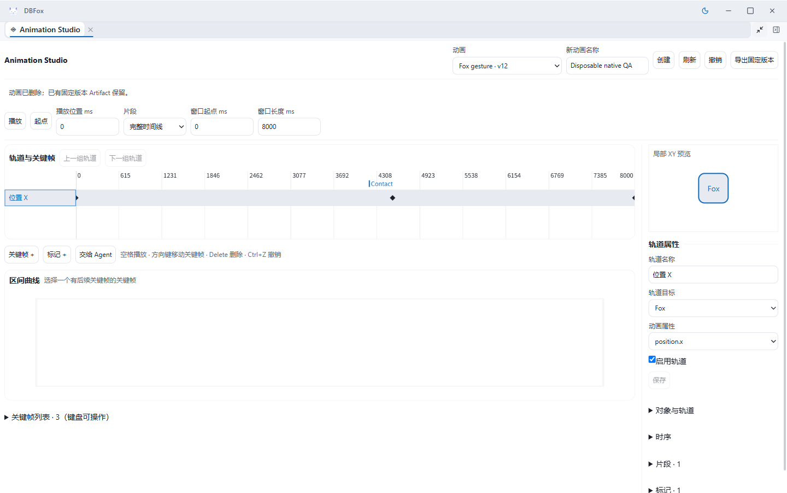
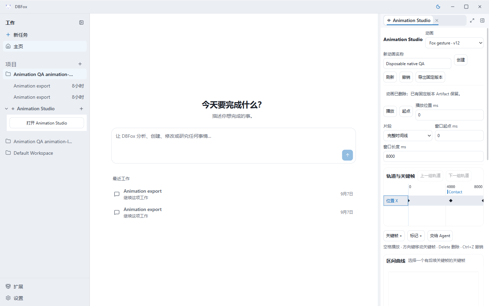
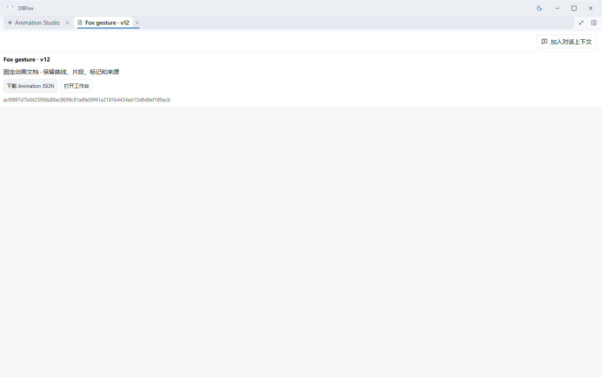

# Animation 作者验证记录

> 状态：当前
>
> 日期：2026-09-07
>
> 身份：Animation 作者；本记录不是独立质量审查或发布批准。

## 候选与范围

在 `creative/animation` 的 `1b175d7354d64c033b591d3ea4bb2c913ebd1139` 上新增 `dbfox.animation`。候选版本 **1.0.2**，签名包 digest 为 `840b1f4d4f00572f98633207bc7f6a29398a6722308e8ea3c73e6cc4d71fbc87`。未修改 Core/SDK；原有 Story、Workspace、Host、工程合同等 dirty baseline 未纳入本候选。

实现了本域规范文档、20 个 typed 增量工具、SQLite CAS/receipt/undo/diff、固定版本 Artifact/Representation、Canvas 时间线与曲线编辑、键盘替代、片段/标记/时序/轨道编辑和原生下载。Three 只负责可丢弃的数值/播放投影。模型与运行限制见 [当前架构](../architecture/animation-dlc.md)；使用及构建见 [DLC README](../../dlcs/dbfox.animation/README.md)。

## 验证结果

| 验证 | 结果与实际边界 |
| --- | --- |
| Backend | 最终包 19 passed，5.21s。覆盖真实签名包激活/停用、事务/CAS/并发竞争/取消/receipt、无变化、版本与数据损坏、增量工作流、历史/undo/diff、固定 JSON，以及真实 Scene Representation 对象消费 |
| Three | 5 passed。覆盖一小时间线上的 1ms 分辨率、混合原生插值、LoopOnce 重播、非破坏 clip 裁剪、marker；20,000 keys 与 10,000 次 seek 的 Node 数值探针约 11ms，此数值不是浏览器/GPU 性能结论 |
| 生产 RunLoop | [12/12 类用例](../../verification/bench/capabilities/dbfox_animation/evidence/author-bench/report.md)通过。真实签名包、迁移后元数据库、Tool Runtime、资源冻结与 Artifact 生产；持续工作流 20 次工具调用，最大 2048 keys、provider 可见 observation 最大 8086 bytes。scorer 核对本域权威事实与运行时结果 |
| 前端 lint | `desktop npm run lint` 通过，0 errors；5 条既有 Host warnings。首次检查发现未加命名空间的样式类，最终 1.0.2 已统一 `dbfox-animation__*` |
| 语法与静态检查 | DLC JS `node --check`、本域/bench/测试 pyflakes 通过；Electron Main/Preload 构建通过 |
| 原生 UI | 实际 Electron Main/Preload/EngineSupervisor 与 Host Dock，未用 viewport 仿真替代；311/311 与 1432/1432 client/scroll width；控制台 0 errors、1 条既有 warning |

基准使用 ScriptedProvider，以确定性请求驱动生产执行链。没有调用付费或真实模型端点；12/12 不代表模型选择工具的准确率、创作质量或未知任务成功率。独立审查、跨 DLC 组合和全仓发布门禁由 Director 调度。

`git diff --cached --check` 仅报告生成的 Three bundle 内上游 GLSL 字符串空白（trailing whitespace / space-before-tab）；未手工改写第三方输出。排除该单一生成文件后的作者源码/文档检查通过。

## 原生操作与证据链

原生 QA 保留同一外部 runtime/profile，依次通过公开安装/选择入口更新 1.0.0 → 1.0.1 → 1.0.2，原文档和版本未重建。最终 [只读审计](evidence/animation-author/native-audit.json) 核对 selected digest 与六个关键生产文件逐字节一致，并重新计算所有文档历史 hash。

1. 1.0.0 上用真实鼠标/键盘完成：Contact marker 4000→4200ms；clip 0..8000→500..7000ms；Bézier 第一手柄 .25/0→约 .290823/.2；contact key 4000→4499ms 拖动，再按一帧移动至 4533ms。小文档由 v7 变为 v12。到末尾播放后点击播放能重新开始；播放本身没有产生 owner 写入。
2. 1.0.1 校正窄时间尺标签密度；原生打开 2048 keys 文档，工作台后代 DOM 为 428 个，键表分页 50 行。通过键表将 k0 的 value 改为 5，head 从 v11 到 v12，key 数量保持 2048。曲线/clip/marker Inspector 和宽窄截图保留为 `*-final.png`。
3. 最终 1.0.2 复验命名空间 CSS、原生宽窄 Dock、加载原有 v12、导出与下载。通过 UI 创建 `Disposable native QA` 后用文档管理删除，活动列表移除；SQLite 新 revision 的 status 为 deleted，历史仍保留。截图 `*-1.0.2.png` 属于最终候选。

[测量与截图 hash](evidence/animation-author/browser-measurements.json) 明确标注各阶段，避免把旧截图冒充最终包。原生截图：







下载使用 Electron `will-download` 接收真实响应流，由 QA launcher 显式指定本地保存位置（`controlled-native-save-path`）。这验证真实下载字节，不宣称无人干预操作了 OS 保存对话框。三次 completed 下载中，v9 JSON 为 783 bytes，SHA256 `c03d187ab9654289496674c12202bb7dcc60a1f75da76e891e925dd997ee436b`；v12 两次均为 798 bytes，SHA256 `acf0697d7b0425f06b88ec8699c91a8fe09f41a2181b4434eb13d6d6ef189acb`。全部等于对应不可变 revision 的 canonical UTF-8 字节。旧 v9 在后续编辑与包更新后仍可验证。

## 交接与未决事项

- **Host 项目删除接入缺口**：public BackendExtensionHost 目前没有项目删除 lifecycle callback。owner `delete_project` 已实现并测试原子级联清理，但没有自动接入 Host 项目删除。此项需要 Director 在真实公开边界解决，不能宣称项目删除全链已完成。
- **Scene 组合验收待独立执行**：产品仅通过公开 `artifact()`、`read_artifact_representation()` 消费精确版本/hash 和稳定对象 ID；测试用了真实 Scene Representation 与 source store，但 RunContext 为验证用 facade。尚未证明多签名 Scene+Animation 的完整生产 RunLoop 授权组合。
- **UI 轻微遗留**：删除测试文档后切换到其他文档，上一条成功 notice 会暂时保留到下次操作。最终截图如实保留该提示；它不表示当前选中的 Fox gesture 被删除，活动资源与持久状态均正确。独立 UI 审查可将此作为局部易用性修正。
- 预览明确是 Three 求值后的局部 XY 示意，不是完整 Scene 3D renderer。完整历史采用快照保存，保留 Artifact 所需旧版本；未加入自动 GC。首次加载 20,000 keys 需要分页读取，DOM 有界不等于无首载成本。
- 未声称生产打包 CSP、全量前端/系统回归、真实模型能力或独立红队通过。未发布；未使用付费 API。

外部原生 profile 与数据库留在 `D:/Project/DBFox-worktrees/creative-program/animation-browser-runtime-v4` 供独立验证员读取；不提交数据库、日志、包、密钥或 Electron profile。本作者启动的 Electron、Vite 与 Sidecar 已结束，5191/19241 无监听。

## 可复现命令

从 Animation worktree 根运行，使用已安装项目依赖的 Python：

```powershell
python -m pytest verification/tests/system/test_animation_dlc.py -q --tb=short
node --test dlcs/dbfox.animation/tests/playback.test.mjs
python -m pyflakes dlcs/dbfox.animation/backend verification/bench/capabilities/dbfox_animation verification/tests/system/test_animation_dlc.py
python -m verification.bench.capabilities.dbfox_animation --output output/animation-independent-bench
python -m verification.bench.capabilities.dbfox_animation.audit D:/Project/DBFox-worktrees/creative-program/animation-browser-runtime-v4 --output output/animation-independent-audit.json
```

bench 输出目录须不存在，避免覆盖旧结果。原生重启方式见 [bench README](../../verification/bench/capabilities/dbfox_animation/README.md)，同一 profile 可用 `--reuse --accept-downloads`；使用 5191/19241 前应先确认无其他进程占用。
