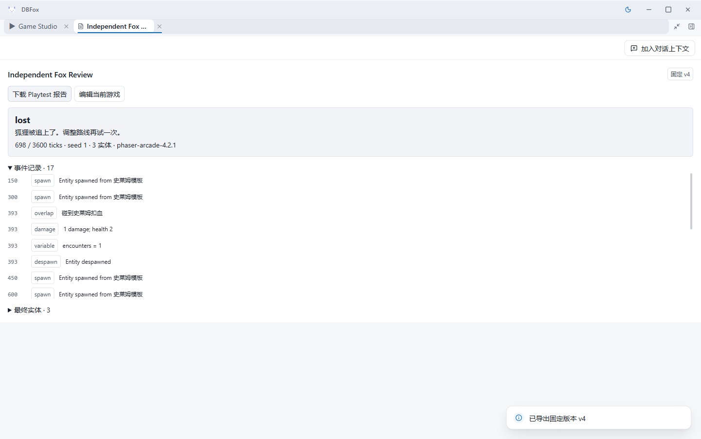
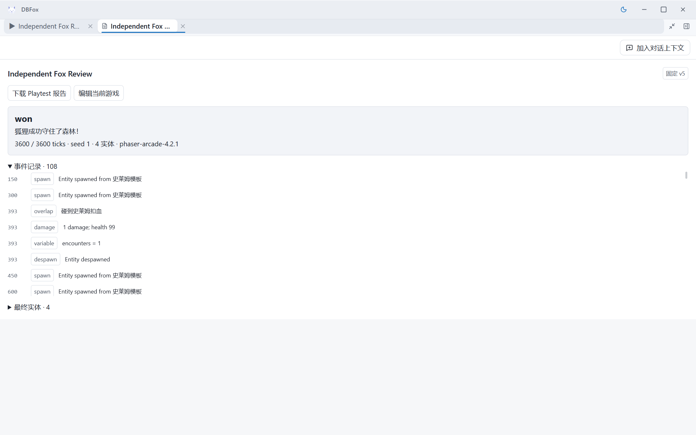
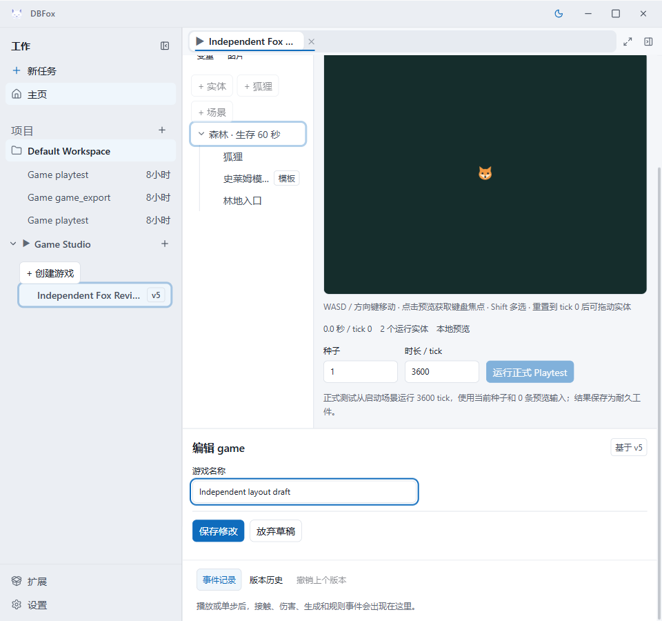

# Game 独立原生运行证据

> 文档类型：质量证据
>
> 状态：当前
>
> 最后核验：2026-09-07
>
> 适用范围：Windows x64、Game 作者候选 `737a1f1c`/`031a5f11`，独立树 `8ebcf96b`

## 结论

真实原生编辑、准确撤销、冷启动恢复、Phaser 失败与成功结果、不可变工件和实际下载通过本次独立检查。随后具体作品定位和Host窄窗两项确认问题已修复，并通过下文独立原生收尾；当前候选可进入根分支集成，最终多能力世界任务仍不属于本项结论。

当前 Core 基线 `94294767`。独立完整签名包 digest 为 `7fa7e692cf09c2786b890a599e70c0444f9019d31d74452ba34a0c58635f235d`，14个前端文件逐个与实际安装来源核对。Electron 使用生产 renderer 与逐字 Host CSP，经真实 Main/Preload/EngineSupervisor 启动源 Python Sidecar。没有替换 Phaser、伪造 report 或执行第二套 RunLoop。

## 实际结果

| 检查 | 独立事实 |
| --- | --- |
| 规范编辑 | UI 创建 v1、狐狸示例 v2；变换检查器保存 v3，完整文档只有 player.transform.x 从400到480 |
| 撤销 | v4 的完整文档及 SHA256 与 v2 完全相同，所有对象 ID 保持 |
| 预览 | 单步精确到 tick1，暂停200ms不推进，重置到tick0 |
| 正式失败 | 原 ActionRun `run_fb28d39b9f504296b2d8cb511834a4b1`，真实 Phaser v4 seed1、698/3600 tick、lost、17事件 |
| 冷启动 | 两次原生窗口正常关闭，launcher exit0；中间 `--reuse` 后各固定历史页与关闭前逐项相同 |
| 正式成功 | 只改 player.health 的 initial/maximum 3→100 得到v5；原 ActionRun `run_776e124c458d43f39b7a82b877316d48` 实际 won/3600、108事件 |
| 固定文档 | v4规范 SHA256 `165e2f9c24f0e0cee66318f71cdcb591f761ecc991893563eccf74721b540ed0`；v5为 `2ad67acb513575c94543180b6a908724e83e677634920516005fa9eb2b66ef50` |
| 下载 | 实际 DownloadItem completed；v4报告4112bytes、Game包4338bytes，分别与公共 Representation stream 原字节相同 |
| 旧结果不随当前作品变化 | v5成功后再读两个v4 Artifact，源版本/指纹/导出字节仍与v4捕获相同 |
| 固定预览只读 | 17个被观察请求中无领域写请求；固定版本播放/暂停/重置均可用 |

步骤、可复查脚本和脱敏汇总见 [独立 testkit](../../verification/testkit/game_independent/README.md) 与 [audit.json](../../verification/testkit/game_independent/evidence/audit.json)。不重复计算作者的32项后端或7项前端测试作为独立新测试；另外的 [9项后端红队](game-independent-redteam.md) 和 [Pixel→Game组合](pixel-game-composition-verification.md) 各自说明范围。

## 发现的问题与结论限制

1. **Game工作区定位**：初次创建使用通用 `Game Studio` tab，正式报告自动打开后再切回，回到游戏库而非先前作品；下拉框仍列出原游戏，数据没有丢。源头应使用已有 Host 具体作品 target/authority 合同，不增加另一个全局状态源。
2. **共享Host布局**：独立定位确认可用696px小于420px对话+320px Dock+8px分隔条，布局库自动折叠到44px，`dockOpen`却仍true。Comic实测内容43px；`88fcb110`只修Shader，不是本缺陷的修复。专门作者正在修复Host分栏与状态一致性，需要真实窗口缩放复验。
3. 后端红队另记录 deferred spawn 与 finish 相邻时资源预算覆盖终态的未复现语义疑点；本轮普通失败/成功不覆盖该临界组合。

本次成功通过调整生命值验证结果响应，**不证明模型学会避障或关卡已平衡**。原生 UI ActionRun 未调用模型；独立组合测试仅外部模型 HTTP scripted。没有 live LLM 质量、Frozen安装包、人工保存对话框或长期堆内存证据。受信 installed renderer 的 report 交接不是面对任意恶意 renderer 的计算证明。

重连CLI时读到旧页面关闭过程 `playtest.detach` 的409控制台条目，未宣称零控制台错误；两次Host进程均正常退出且端口释放。捕获脚本早期因CLI事件回调不支持全局URL而中断两次，改为字符串拆分后完整重跑只读阶段，未重放任何领域写入。

## UI修复后的独立收尾

独立树挑入作者 `4e21185c` / `60456cf9`，对应本树 `f1edf1f4` / `a9c41424`。另一个非作者角色完成 [独立源码与40项React/Host测试审查](workspace-compact-independent-review.md)，未发现新授权或镜像状态问题。Root 实际生产构建暴露 `.test.tsx` 未从产品类型检查排除，独立审查员也复现四处 TS2591；`809fa7ea` 在既有生产 exclude 补全该扩展名，测试仍由 `typecheck:test` 检查。修复后生产构建、测试类型检查、lint通过；lint保留5项既有warning。

同一外部数据集通过正常 disable/uninstall/install/enable 升级到新签名包 `39abf5cf53ef5f2c70356af892f3d5230a87faf9cee62e4a3d3c0a948468c054`，14前端文件与新源码再次逐项匹配。真实 Main 测试入口仅对这个窗口执行 `BrowserWindow.setSize`，保留逐字 Host CSP；没有使用 Playwright viewport emulation 冒充原生尺寸。

- 实际960px窗口、导航展开时可用约696px，Dock占满可用宽；对话width0，其外层有真实inert。20次真实Tab没有进入隐藏对话。
- 1440px恢复分栏；960px收导航后可用912px，也恢复分栏。未提交的 `Independent layout draft` 跨宽窄、导航与全屏/退出均保留，随后明确放弃草稿。
- 关闭Dock显示44px收起轨和可输入对话，重开具体作品成功；宽屏键盘End和指针拖到边缘都保持320px，没有假展开。
- 选中狐狸后导出固定v5 Artifact，再通过真实“更多标签”菜单回到作品，gameId与狐狸检查器均恢复。
- 全部v2..v5公共历史页和当前game summary与此前逐项完全相同，未保存草稿及布局交互没有修改游戏。最后正常关闭Electron，launcher退出0、5184/19230释放。

脱敏尺寸和导航记录见 [ui-audit.json](../../verification/testkit/game_independent/evidence/ui-audit.json)。最初独立尺寸探针误读库内层div的inert，查明实际inert在外层后修正探针；最初返回脚本误点仍可见的Artifact tab而未打开折叠菜单，实际菜单操作后完整重跑成功。这两项是验证夹具修正，没有修改产品来迎合断言。

原生“更多标签”菜单会触发现有Radix组件的inline-style CSP控制台警告，本次实际菜单和返回操作均成功，未放宽CSP，也不宣称零控制台错误。跨屏DPI变化、屏幕阅读器、长期ResizeObserver压力不是本次结果。Host尚无项目删除API，故自动清理DLC Project state是明确未提供的生命周期能力，不能声称已接入，也不把它描述为已触发的数据泄漏。
