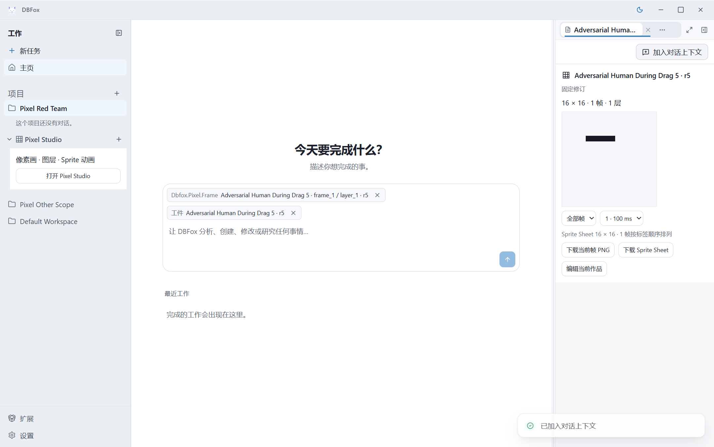

# Pixel 独立对抗审查

> 文档类型：质量证据
>
> 状态：当前
>
> 最后核验：2026-09-06

**独立结论：接受 Pixel 候选 `88e7c7d1`，本轮确认的两组 P2 已独立关闭，无遗留 P1/P2。**
尚待 Director 集成，不代表整个 Creative Program 完成。验证员未编写 Pixel 产品；此前独立 Verification
已以 `6ed057d0` 完成，随后 Scene controls 有界独立回归以 `ea720a8f` 单独完成，现在正式
转任 Pixel Adversarial Reviewer。旧 25 个故障测试、17 个 Bench 测试和实际 200 帧桌面
结果不计入本轮新增攻击。首轮产品基线为 `5f222e4e`；最终候选为 `88e7c7d1`，共享生产
工厂修复为 `fac8a170`。本验证员仅修改测试、证据、报告与 owner 状态。

已完整重读 lead-pixel.md、当前领域模型/存储/Tool/Representation 合同及独立验证报告。
新增测试位于 [test_pixel_dlc_adversarial.py](../../verification/tests/system/test_pixel_dlc_adversarial.py)，
及 [test_pixel_artifact_adversarial.py](../../verification/tests/system/test_pixel_artifact_adversarial.py)。
复用完整签名安装的 Runtime 夹具，公共操作和 ToolRuntime 仍经过正式注册入口。

## 已确认问题

| 严重度 | 最小复现及影响 | 权威修复点与状态 |
| --- | --- | --- |
| P2 | 将当前 frame 的 object_identities.created_revision 改为 0、-1、0.5；公开 documents.get 仍成功。合法 schema/hash 不应让非法 birth revision 成为有效对象身份。三个参数均修前失败。 | Director 在 [store.py](../../dlcs/dbfox.pixel/backend/store.py) `_revision` 修复 birth 正整数、存在修订、不超 head 及合法 kind 校验；原始攻击未放宽，最终候选独立通过。 |
| P2 | 人类创建 20 帧 tag，末 12 帧采用与文档不同的顺序。正式 pixel_inspect(kind=tags,page_size=1) 返回前 8 项并 truncated=true，但 has_more=false；其他页只翻标签目录。Agent 无法保留隐藏成员顺序进行 tag_set。 | Director 在 [contracts.py](../../dlcs/dbfox.pixel/backend/contracts.py) MetadataInput/InspectInput 与既有 store.inspect 增加 tag_id，共用 Representation 成员目录。独立明确更新为先读标签目录、再按观察到的 tag_id 分页；原完整 20 项顺序断言保留。错误组合、固定历史页、未来版本，以及 251/256 帧完整顺序均通过。 |

首批命令从 creative-pixel 根执行：

```powershell
D:/Project/DBFox/.venv/Scripts/python.exe -m pytest verification/tests/system/test_pixel_dlc_adversarial.py -q --tb=short
```

实际 **7 passed / 4 failed / 5.10 秒**。7 个通过攻击对 canonical schema/string/float、
duration bool/float、layer scalar/null、pixel string 重算 hash 后仍被拒绝。失败分别是
3 个 birth revision 参数和 1 个长 tag 读取缺口；没有将产品缺口改成通过断言。

修复后的独立命令仍为上述单文件，新增参数组合与历史页攻击后，实际 **18 passed / 3.05 秒**。
此结果不是引用作者测试：本验证员读取新合同并独立执行，产品文件仍由 Director 所有。

Artifact 首轮新夹具记录 **9 passed / 11 failed / 43.54 秒**；11 个失败均发生在后续 Run
入场前，原因是测试尝试以另一 owner 抢占仍有效的 fixture coordinator 租约。已改为延续同一
`pixel-bench` coordinator，并将引用按实际 model.js 的 `dbfox.pixel.frame`/pixel locator 构造。
没有放宽生产租约或 Artifact authority，也不把该夹具错误列为产品缺陷。

## 最终新增攻击

从 creative-pixel 根执行：

```powershell
D:/Project/DBFox/.venv/Scripts/python.exe -m pytest verification/tests/system/test_pixel_dlc_adversarial.py verification/tests/system/test_pixel_artifact_adversarial.py -q --tb=short --show-capture=no
```

实际 **49 passed / 94.39 秒**，其中领域/耐久/规模 28 项，Artifact/Run 21 项。

| 攻击面 | 新证据与结果 |
| --- | --- |
| Canonical 与耐久身份 | 七类 scalar 破坏即使重算 hash 也不能读取；birth 三参数拒绝。原 unknown/schema、取消和 crash 前事务结论仅作为前期背景，不冒充新增测试。 |
| 总预算与帧索引 | 128×8×256×1 恰为 262144 槽；第 257 帧/第二层原子拒绝，随后释放空间可使用被拒的 ID。127/128/129 帧变更的截断 flag、全部分页 diff、undo-of-undo 的版本和重复 hash 一致。 |
| 标签与 PNG | 251 帧素数数量采用 128×2008，256 帧采用 8192×32；Pillow 独立逐帧坐标/alpha 检查。先导出再反转当前 tag，旧 Artifact 的 PNG、layout 与 16 项成员页仍保留全部历史顺序；Tool 每页不足 16 KiB。 |
| 库配额与隔离 | 128 活动文档上限；删除后可创建，满额恢复拒绝；另一 Project 可独立创建。错误 owner/另一 Project 的 document selector 不继承当前资源权限。128 MiB retention 的产品计费边界做源码审查，本轮未填满物理磁盘。 |
| 真正进程死亡 | 子进程在签名包真实 COMMIT 返回后 os._exit(27)，重开后人类先写新修订；精确 ToolRuntime.reconcile 返回旧操作的不可变版本/Artifact，保留后续人类修改。 |
| 源码完整性 | frontend/model.js 或 PyPNG 仅增加换行，原签名包安装仍拒绝；既有已启用包 digest 不变。 |
| Artifact 权限 | 实际 Invocation 产物证明写前 refs 与写后 payload 的差别；跨 Run、Session、visibility、未来序号、非终态、失效/伪 producer 均复用 availability，selected/recent/previous 不绕过。DERIVED_FROM 必须精确且无环；supports 不授予相同权限。 |
| 生产工厂 | `build_product_run_loop` 仅替换外部 model_factory，未由测试注入 resolver。真实文档 onAsk 后续 Run 的 inspect→layers→rect 成功；从原生观察读取对象 ID/version。共享漏装 resolver 的发现归 Shader/Director，本轮独立复验 Pixel 消费路径。 |

新增规模夹具首轮 **4 passed / 1 failed / 28.84 秒** 的失败是重复 Project.name，改为唯一
Project 名后，256 帧原断言通过 **1 passed / 21.71 秒**。工厂补充用例首轮错取 mutation
facts.summary，已按既有扁平 MutationResult 读取，随后 **1 passed / 4.04 秒**。最终 49 项
覆盖了上述修正后的全部场景；没有用包装层修产品或放宽权限。

## 冷签名真实桌面

最终完整包 digest 为 `2b7cd5337f8a847bc1d73dfa047b3b42022fe9f0ace383678161d7ea3b97c6f9`。
使用真实 Main/Preload/EngineSupervisor、正式 HTTP operation、ActionRun 与 Host Representation；
Renderer 是隔离 Vite 开发入口，未替换 Canvas。独立运行时在系统临时目录保留，未提交数据库。

| 场景 | 实际证据 |
| --- | --- |
| 可见画布 | [手势证据](../../verification/bench/capabilities/dbfox_pixel/evidence/redteam-gestures.json)：130 点笔迹整笔取消，Esc 取消，held pointer 期间 Space 关闭 tab；均零写。关闭后 Canvas=0、迟到轮询=0；重开 1 tab/1 stylesheet。 |
| 人类/Agent 竞争 | 手势期间人类正式 typed edit 将 r4→r5，画布仍明确显示 r4，mouseup 收到 PIXEL_CONFLICT/409；仅两次 POST（人类成功、旧手势拒绝），无自动重发，最终 hash 等于人类提交。 |
| 关闭旧编辑器 | [关闭与导出](../../verification/bench/capabilities/dbfox_pixel/evidence/redteam-artifact-close.json)：正式 export 成功后 hold 同源 Session GET/200，close→reopen 再释放；旧调用不打开 Artifact，export POST=1。用户下一次显式 export 正常显示 r5 的实际 16×16 PNG 预览。 |
| generation 与资源 | [流取消](../../verification/bench/capabilities/dbfox_pixel/evidence/redteam-generation-stream.json)：真实 sheet Representation 已返回 200，hold 响应后停用/重启/启用，generation 1→2→3、stylesheet 1→0→1。旧预览 Blob 已 revoke，旧流没有执行下载 anchor，新实例有新预览。未把一次 200 或 toast 记为已完成文件下载。 |
| onAsk 与固定历史 | [耐久核验](../../verification/bench/capabilities/dbfox_pixel/evidence/redteam-durable.json)：真实按钮得到 document authority/frame locator 与 artifactId-only。新 Session 通过真实生产工厂 inspect→edit，Run `run_c0417f86ca414826879c46d9ac69022c` completed，r5→r6 仅索引 240 变化；原 r5 PNG 仍为 84 B、SHA-256 `689212f1f23ca70811ed4ba940b86057f418d6f17a0aeb92beb8724136c90731`。 |

两次 export 各有正式 succeeded Invocation、attempt=1 与固定 package digest。
第一个取消的是 UI 导航等待，后端完成的 Artifact 保留；未把取消解释为回滚已完成写入。

Artifact 从另一个 ActionRun Session 附加到新会话，仍按既有 exact Input/Session fence
被拒绝。合法用户路径是直接引用当前文档/帧再 inspect/edit；同 Session 的当前 export 还需
精确当前资源 refs。mutation 工件的写前来源不会被自动提升为写后资源权限。



## 夹具修正与清理

首轮桌面脚本点击已展开 Project 将资源折叠；随后精确文本匹配漏掉 alert 的关闭按钮文本，
以及把 Browser Fetch `status` 当作函数，均属夹具错误。CLI callback 没有全局 crypto，改到
Renderer 生成 mutation ID；该错误发生时旧 finally mouseup 正常结束了一笔尚未提交手势，
产生 r2，事实保留，后续清理先 Escape。两次后续探针实际完成人类 r3/r4 修改和正确 409，
但 CDP 对 POST 的 postDataJSON 都返回 null；最终保留 null，并以真实状态码、网络次数、
显示修订和耐久 head 验证，未编造缺失请求正文。最终完整可重复场景从 r4 开始。

控制台的三次 409 对应上述冲突攻击；一次 blob ERR_FILE_NOT_FOUND 对应 revoke 验证；
重启中旧 endpoint 的 activation 请求出现 connection refused，新 generation 已实际恢复。
开发 Electron 的 CSP 提示未被当作生产打包结论。

[结束状态](../../verification/bench/capabilities/dbfox_pixel/evidence/redteam-finish.json) 确认
所有 tab/Canvas/预览已卸载、Blob revoke、注入的 anchor 诊断恢复，1.4 秒无迟到 owner 请求。
[实例清理](../../verification/bench/capabilities/dbfox_pixel/evidence/redteam-cleanup.json) 确认
本任务 8 个进程均退出，5179/19225 无监听，launcher exit 0，Playwright session 已关闭。
正常点击窗口关闭后 CLI 来不及读取已销毁页面 URL 而返回错误，未据此误判未关闭。

工程合同 **45 passed / 4.95 秒**。新 4 个 Python 文件 pyflakes、新 4 个 CJS 的 node --check
均 exit 0。签名攻击进一步收紧为必须返回 DlcError/HASH_MISMATCH，定向复跑 **2 passed /
2.50 秒**，没有新增或减少用例。本轮未调用付费模型；ScriptedProvider 只证明运行机制与领域结果，不证明真实 LLM
创作质量。前期独立 Verification 的创作压力/200 帧 UI/下载证据保留原阶段归属。
