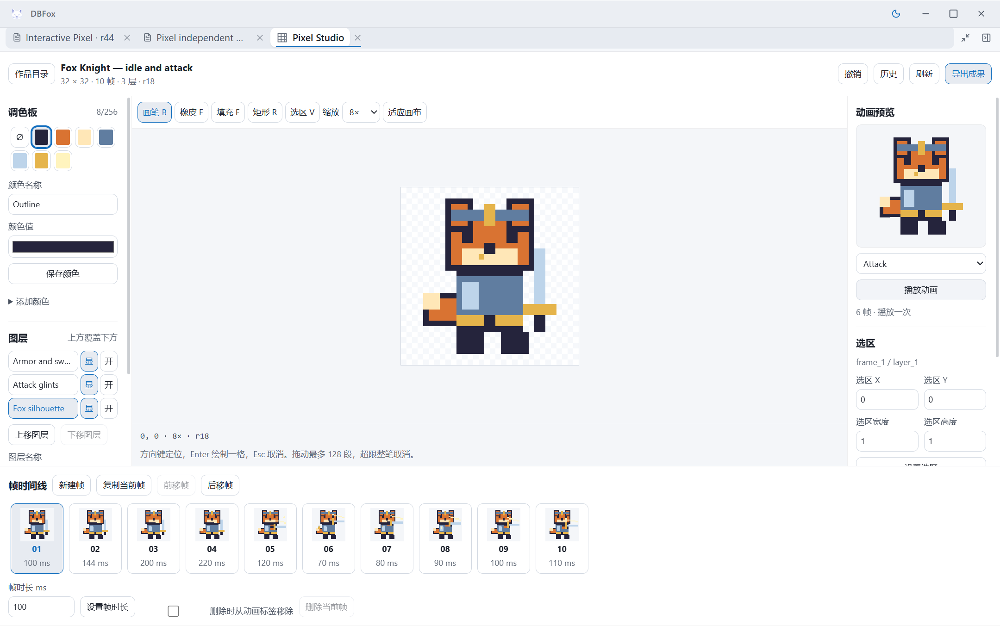

# Pixel 独立验证

> 文档类型：质量证据
>
> 状态：当前
>
> 最后核验：2026-09-05

独立 Verification 已完成。验证者此前参与 Voxel 后端和 Scene 独立验证，没有编写 Pixel
产品。当前候选是 Pixel `5f222e4e`、Host stdout 修复 `734bcbb2`；最终签名包 digest 为
`cf43cb1f28538119a437c68f13ef8b152d2cd18c7acf9d18f9506a713746c299`。
随后共享 Tree 修复 `5dc69721` 的热更新没有改变该包。本阶段不代替单独分配的
Adversarial Reviewer，也不宣称 Creative Program 已完成或 Pixel 已集成。

已完整读取原 Lead 模板、独立交接、CONTRIBUTING、当前领域合同及作者证据。作者的
35 项后端、28 项前端结果属于作者验证，不计入下列独立结果。

## 可复现结果

命令均从 worktree 根运行，Python 使用 `D:/Project/DBFox/.venv/Scripts/python.exe`。

| 命令 | 本轮实际结果 |
| --- | --- |
| `python -m pytest verification/tests/system/test_pixel_dlc_verification.py verification/tests/bench/test_pixel_bench.py -q --tb=short` | **42 passed，118.04 秒**：25 个独立故障/持久化测试，17 个 Bench 测试 |
| `python -m verification.bench run capability.dbfox-pixel.scripted --output verification/bench/capabilities/dbfox_pixel/evidence/current` | **15/15**，0 unscored，exit 0 |
| `python -m pytest verification/tests/system/test_engineering_contracts.py -q --tb=short` | **45 passed，4.37 秒** |
| `python -m pyflakes verification/bench/capabilities/dbfox_pixel verification/tests/bench/test_pixel_bench.py verification/tests/system/test_pixel_dlc_verification.py` | exit 0 |
| `node verification/bench/capabilities/dbfox_pixel/browser-stdout-probe.mjs` | 修前 exit 1，修后 exit 0，真实子进程写满 4 MiB pipe |
| `cd desktop; npx vitest run --config vitest.electron.config.ts main/__tests__/engine.stdout.test.ts --maxWorkers=1` | **1 passed，377 ms**，共享独立回归已单独提交 `6ea0788a` |
| `cd desktop; npm run build:electron-host` | exit 0，真实 Main/Preload 供冷启动使用 |

统一 CLI 不覆盖已存在的输出目录。首次把输出指向已有 `evidence` 时，框架在写报告阶段
以 `FileExistsError` 拒绝；随后使用新的 `evidence/current` 正式运行并生成报告，未降低门禁。
早期 14/14 结果仍保存在 evidence 根，最终结果以 [current/report.md](../../verification/bench/capabilities/dbfox_pixel/evidence/current/report.md) 为准。

## 生产路径、评分与压力创作

复用既有 Bench manifest、report、TrialOutcome、ScriptedProvider 和真实迁移。suite 对
完整 Pixel 源码签名，并核对包内每个前端文件与当前源字节完全一致，然后正式信任、安装、
激活。执行链是 Session admission → RunLoop → ToolDispatcher → ToolRuntime → 注册的
领域 Tool/Store → 正式 Invocation/Observation/Artifact 持久化。只有 Responses 模型事件
受控；这证明确定性的运行机制和领域结果，不证明真实 LLM 的创意质量。

15 类分别覆盖简单创建、增量修改、多阶段、无效指令恢复、先检视、stale、no-op、歧义、
大文档、上下文预算、人类编辑后 Agent、negative 不修改、整文档替换拒绝、200 帧和狐狸
骑士压力创作。模型的动态 ID/revision 仅来自原生 function_call_output；Human 返回不回填
模型。普通修改在同一个 Run 内完成，只有显式用户澄清才开启后续 Run。

狐狸骑士是实际构建的 32×32、3 层、8 色、4 idle + 6 attack 动画，10 个姿态的解码 RGBA
均不同。完整初作 r7 后执行添加、删除、局部脸部调整、帧和层重排、20% 时长调整、询问
歧义并在澄清后继续、拒绝旧版本、人类盾牌修改后重新检视、局部 Agent 高光、临时修正及
undo、最终 refinement，到 r18。稳定 ID、未受影响的帧/层/区域、文档 hash、版本、操作
数量和真 Invocation 来源均由领域 scorer 检查；不接受整文档重造。

[最终压力导出证据](../../verification/bench/capabilities/dbfox_pixel/evidence/current/export-evidence.json)
包含初作和最终版本各 single/all/idle/attack 共 8 张 PNG，全部经过正式固定 Artifact 的
Representation stream，再由开发依赖 Pillow 解码，与独立 RGBA 合成规则逐字节比较。
全帧 sheet 为 320×32，idle 128×32，attack 192×32。初作 r7 的产物在后续修改后仍固定。
另外，200 个 128×1 帧的正式 RunLoop 测试输出 6400×4 sheet，验证所有透明像素、首尾
标记、200 帧顺序及无额外 padding。

最终 15 类 Bench 的最大 Pixel context 为 **193 chars**，最大原生 Tool observation 为
**8304 bytes**。64 帧 Unicode/tag 压力仍独立保留；200 帧新增 case 在同 Run 通过 13 个
16 项分页读完帧目录，跨全部 200 cel 的修改/undo 都只返回 128 changed IDs，并明确
`changed_frame_ids_truncated=true`。完整证据在 [trials.json](../../verification/bench/capabilities/dbfox_pixel/evidence/current/trials.json)。

## 独立发现及修复复验

| 发现 | 修前证据、影响与权威修复 | 独立关闭证据 |
| --- | --- | --- |
| P2：head 回退或 parent 行缺失仍可读 | `store.py` 原 `_revision` 没有证明 MAX revision/head 和真实父行；原 15 故障中 2 fail / 13 pass | 产品 `b6987f23` 的 `_document_index` 被 get/head/list 共用；补公开 head/list/固定历史攻击后原 36 项通过，最终 42 项再次通过 |
| P2：64 帧硬限不满足数百帧 | 200 帧公开操作原失败于 `frame_create.position<=63`，1 fail / 21 deselected，5.12 秒 | `5f222e4e` 统一 256 帧/位置/tag，保留原槽/字节预算；200 帧正式 RunLoop、独立宽帧表示及真实桌面编辑均通过 |
| P2：回执派生摘要可损坏而被重用 | 改 200-cel 回执的 truncation=false、删除 truncation、changed=false，同 ID 同 payload 重试均接受；3 fail / 22 deselected，7.39 秒 | `_receipt` 对绑定 expected revision 和固定结果 revision 重新验证派生 changes；原攻击不改，3 pass，6.87 秒，并包含在最终 42 项 |
| P1：Host stdout backpressure 冻结 Sidecar | 真实 Electron 约 496 请求后连健康读取也悬挂；真实 EngineSupervisor/子进程 4 MiB probe 显示 ready 后流被暂停，测试控制 resume 后立即解除 | 现有握手 finish 在 close 后 `stdout.resume()` 丢弃后续原始字节；独立 probe/unit 通过，真实 Electron **1100 次正式 head HTTP 全部 200，6.8735 秒，同 generation=1，head 未变** |

stdout 源修复由 Director 编写；验证者仅编写独立测试，单独共享测试提交没有混入 Pixel
内容。回执、索引和规模修复均由产品负责人实施，未通过修改测试来迎合产品。

42 项还覆盖完整签名激活/停用/重激活的贡献清理、冻结历史读取、cancel/timeout 前后
界限、commit 后未知结果的精确历史 reconcile、receipt SQL trigger 失败回滚、真实子进程
在事务中 `os._exit(73)` 后无部分 head/revision/对象身份/receipt、human/ToolRuntime 并发
只成功一次、schema bool、非法 cel、损坏 receipt 与未知 schema fail-closed。

## 真实 Windows Electron

通过本 suite 的 `browser-launch.mjs` 启动真实 Main、Preload、EngineSupervisor、Sidecar
和 Vite。任务 runtime/profile 与签名包在仓库外；无付费 Provider、没有公开 Token。
受控浏览器操作使用 Playwright CLI 接入本任务的 CDP。初始浏览器、重签冷启动和后续
生命周期均走正式产品；没有用 memory operation、伪 Artifact envelope 或 Renderer fs
写文件替代后端和下载。

- 真实 Canvas 完成 brush、erase、矩形、区域 copy/mirror/rotate/move、fill、layer
  增删/显隐/锁定/排序、palette rename、frame 复制/新增/删除/排序/时长、tag 和播放。
  [初始编辑](../../verification/bench/capabilities/dbfox_pixel/evidence/browser-edit.json) 与
  [当前包 13 类后续操作](../../verification/bench/capabilities/dbfox_pixel/evidence/browser-more-edit.json)
  保留正式响应。初始 r22、恢复 r23 内容形成 r31、冷启保留 r31，当前包增量到 r44。
- 真实 onAsk 产生 owner document authority + namespaced frame object。其引用进入正式
  后续 Run，Agent 先 inspect 再修改，桌面轮询显示结果。最终后续 Run 从实际当前 r45
  读到并修改 r46；版本没有从私有 Store 偷渡给模型。
  [Human → Agent 证据](../../verification/bench/capabilities/dbfox_pixel/evidence/browser-human-agent.json)
  也实证其他 ActionRun Session 的 artifact-only 引用不可在该新 Session 使用。引用不是
  权限升级；可用路径是作品自身“交给 Agent”，让 Agent 重新检视当前作品。
- [真实冲突](../../verification/bench/capabilities/dbfox_pixel/evidence/browser-stale.json)：持有
  旧 Canvas 请求，另一个正式 typed human 请求先写 r45，再释放旧 r44 请求。响应序列
  只有 200、409，工作台读回 r45、提示未重发，未出现 lost update 或自动重放。
- [200 帧测量](../../verification/bench/capabilities/dbfox_pixel/evidence/browser-scale.json)：
  首 Canvas 160 ms，200 次固定 frame read 全部 200，最后帧可选 6270 ms；末页 8 个
  帧按钮，10 个 Canvas，621 个领域 DOM elements，测量窗口内一项 72 ms longtask。
  [第 200 帧实际编辑](../../verification/bench/capabilities/dbfox_pixel/evidence/browser-scale-edit.json)
  从 r10 到 r11，只改 `scale_199` 的 1 像素。播放实际推进多帧。
- [Artifact 下载](../../verification/bench/capabilities/dbfox_pixel/evidence/browser-download.json)
  保留实际 Run/Invocation/Artifact、可见 Dock 和正式 Representation：当前包 r44 的
  PNG 96 B、sheet 115 B；[200 帧下载](../../verification/bench/capabilities/dbfox_pixel/evidence/browser-scale-download.json)
  PNG 75 B、3200×16 sheet 278 B。Electron DownloadItem 均 completed，received=total；
  独立读取落盘文件 hash 与 Renderer blob hash 相等，再对全部 RGBA 比较。200 帧更新
  到 r11 后，r10 导出仍按原修订验证通过。官方 will-download 的 setSavePath 只控制
  原生保存路径，不代表自动化点击了原生保存对话框，文件由 DownloadItem 写入。
- [作用域取消](../../verification/bench/capabilities/dbfox_pixel/evidence/browser-scope-cancel.json)
  持有真实 Session 200 响应，切 Project 再返回，迟到 Artifact 没有打开。
  [生命周期取消](../../verification/bench/capabilities/dbfox_pixel/evidence/browser-cancel-lifecycle.json)
  从 generation 7 经停用 8、重启用 9 后释放旧响应，仍无 late tab；样式 1→0→1。
  [停用与恢复](../../verification/bench/capabilities/dbfox_pixel/evidence/browser-reactivate.json)
  明确停用后 Canvas/style 均 0，重新启用后从正式目录打开仍是 200 帧 r11。
- [375 px 和键盘](../../verification/bench/capabilities/dbfox_pixel/evidence/browser-art-layout.json)：
  document scrollWidth=375，Canvas 256×256，无页面横向溢出；ArrowRight 改视图光标，
  Tab 可进入动画标签。Attack 按 6 帧非循环 tag 自然结束。
  [空态/加载/非法创建](../../verification/bench/capabilities/dbfox_pixel/evidence/browser-empty.json)
  持有实际空目录响应验证加载态；129 宽度被表单阻止，没有发出 create 请求。
- [关闭后重开](../../verification/bench/capabilities/dbfox_pixel/evidence/browser-reopen.json)
  从 Pixel 资源按钮重新打开，1 个 tab、1 份 stylesheet。Pixel 不贡献 Tree leaf，因此
  不把该按钮测试冒称共享 Tree 叶节点的真实浏览器复验。

[375 px 截图](../images/pixel-mobile-layout.png)、[200 帧截图](../images/pixel-two-hundred-frames.png)、
[实际 Artifact Dock](../images/pixel-artifact-open.png) 均来自真实 Renderer。

## 范围和剩余门禁

256 帧上限同时受 262144 像素槽、2 MiB canonical 和历史配额约束；不是任意大小、层数
都能达到 256 帧。200 帧的预览会进行 200 个有界读取，当前实测全量约 6.27 秒，不能
宣传为瞬时加载。375 px 为真实 Electron Renderer 的视口测试，不是新增手机发行支持。

几次 fixture 修正分别是读取 native observation 而非 durable 摘要、恢复时应检视实际
非法区域、单次页大小应为 16、修改后需重新设置选区、一次性 Attack 会自动停播、后台
激活与前端投影应分别等待、停用后需要从正式目录重开作品。这些不记为产品缺陷。

共享生命周期中旧连接断开、取消和故意的 409 会产生预期 console/network 失败记录，
没有把它们宣称为“零错误”。验证只覆盖 Windows 开发 Electron，不包含 Frozen Sidecar
安装包、其他平台或真实 LLM 创作质量。Task-owned routes/PerformanceObserver/CDP 下载
监听在 finally 中移除；任务实例关闭结果记录在 suite 的 cleanup 证据中。后续独立红队
和 Director 集成仍是明确剩余门禁。
