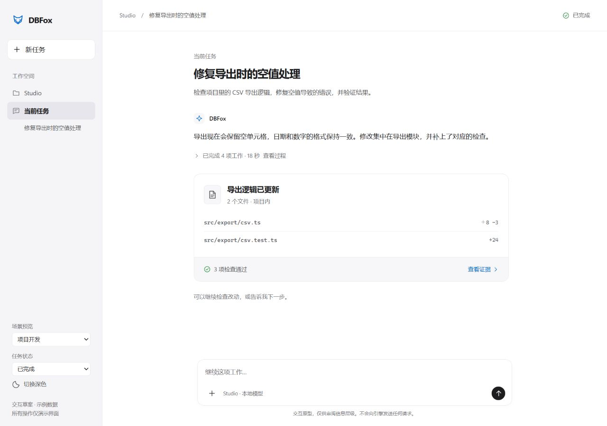
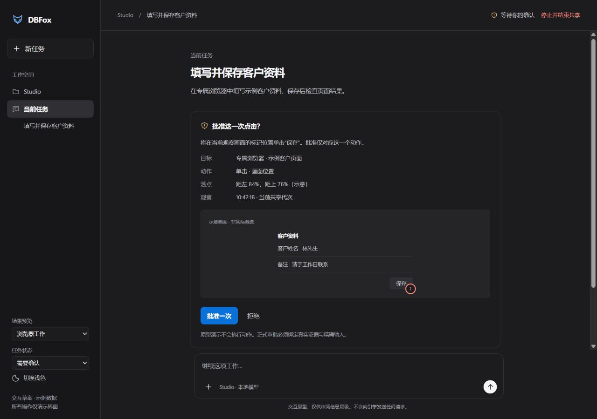
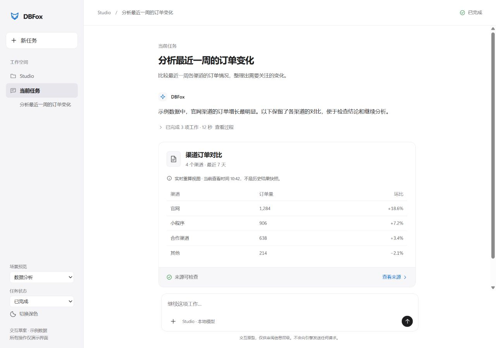

# 工作台交互与视觉收敛方案

> 文档类型：工作台交互方案
>
> 状态：草案
>
> 最后核验：2026-11-20
>
> 配套：[模块质量评审](../quality/module-quality-review-2026-11-18.md)
>
> 原型：[交互预览 HTML](../../desktop/prototypes/workbench-refinement.html)

本方案用于审阅下一步交互方向。HTML 可切换开发、数据、浏览器场景及完成、审批、失败状态，支持深浅色、过程展开和详情抽屉；全部为示例数据与本地 UI 状态，不连接引擎，不执行命令、授权、数据库查询或电脑输入。它不替代现有生产工作台。

其中对话信息流、输入回执和正文引用到 Dock 的实现已于 2026-11-20 落地，当前行为以[Agent 对话合同](agent-conversation-flow.md)为准。本文其他工作台方向仍保留草案状态。

## 1. 设计意图

简约来自信息排序。当前任务、需要用户决定的事项、可检查的交付应该最先被看见。技术过程和详细来源容易找到，但不抢占日常阅读空间。Apple 风格通过自然的系统字体、统一对齐、留白、安静的灰阶与克制的材质表达。继续使用 DBFox 自己的蓝色主操作和图标体系，不复制苹果品牌、窗口红绿灯或受限制的字体资产。

常态画面只保留三个视觉层次：任务正文、一个主要成果区域、轻量上下文/过程。危险操作、失败与停止状态有足够对比，不能为了“干净”隐藏。源于 [Apple HIG 的层级与渐进披露原则](https://developer.apple.com/design/human-interface-guidelines/layout.md)，具体尺寸和业务组合是 DBFox 本方案的设计决定。

## 2. 信息与布局规则

| 区域 | 默认看见 | 按需看见 |
| --- | --- | --- |
| 顶栏 | 当前项目 / 当前任务；运行时必要的停止 | 完整路径、Session/Run ID、引擎诊断 |
| 任务流 | 用户目标；有意义的进展或最终回复 | 每次工具输入、输出、token、全量日志 |
| 过程 | 一行“完成了什么 / 正在等什么”，可展开 | 时间顺序、完整证据与具体错误 |
| 成果 | 一个明确标题、简短说明、可检查入口 | Artifact 类型/版本、哈希、表示列表 |
| 电脑共享 | 当前有效目标、权限、期限与停止 | 已结束的历史共享、技术身份 |
| 表格 | 数据与必要的 live/snapshot、截断信息 | 时延、执行 ID、完整来源、低优先 notice |
| 输入区 | 下一步输入；当前项目/模型与附加入口 | 扩展工具目录、完整配置与能力文档 |

桌面基准宽度 1280–1440，侧栏约 208–224，正文舒适阅读宽度约 660–720。960×640 时优先内容，详情使用抽屉而非继续挤压正文；独立 340px Dock 中采用一列字段和可换行操作。低于产品最小桌面尺寸的响应布局仅为原型可访问性，不宣称新增移动端支持。

同一局部决策区域只用一个实心主按钮。拒绝、取消、查看、停止分别按其语义表达；停止在活动任务中始终容易发现，不能仅在 hover 或溢出菜单里。相同状态不要同时重复为顶栏计数、彩色徽章、说明卡和正文提示。

## 3. 四条工作场景

### A. 接手项目、修复并验证

1. 用户打开文件夹，输入目标。目录和模型在输入旁以一条上下文表达，不先要求配置一面板参数。
2. 电脑、附件、发送共同依赖同一个草稿创建操作。创建中局部提示“正在准备工作区”；切换项目后旧响应不能写入新项目。
3. 执行时显示当前有意义的一步和停止。细节展开后才显示命令、目录、输入与输出；命令审批必须保留真实参数与影响。
4. 完成时先说明改了什么，再显示文件与检查。“验证通过”只基于真实检查；未跑检查就明确说未运行。根进程退出、输出收尾与全部进程结束不要混为成功。
5. 下一步入口是“检查改动 / 继续完善”。完整终端日志属于验证详情，不复制进最终回复。

落点：ConversationCenter、SmartQueryHome、ConversationWorkspace、ExecutionJobsDock / ExecutionLogView、ArtifactViewHost。先处理质量评审 Q1，再做密度与组合调整；不创建新的任务实体。

### B. 数据分析、表格与报告

1. 附件或数据库作为明确输入出现，只有一处来源摘要。询问目标后进入分析，不把所有 Catalog、SQL 和结果表同时打开。
2. 主信息流给出有依据的结论和关键表格片段。SQL 校验或审批只在真实需要用户决定时展开。
3. 结果工具条保留筛选、必要导出和查看完整结果；来源详情使用一个入口。live reexecution 与截断始终在结果旁可见，不藏进抽屉。
4. 刷新失败时说明“当前仍显示上次成功结果”的时间或查询条件。当前页面、筛选和旧数据不能以成功状态混排。
5. 导出的来源、范围和当前过滤规则可检查；不把当前视图重新查询悄悄描述为历史快照。

落点：TableArtifactView / InlineMeta、useArtifactTableData、DataFrameToolbar、Data DLC 的展示。复用现有表格与来源合同，移走冗余视觉包装，不删关键来源语义。

### C. 浏览器或窗口辅助工作

1. 电脑入口打开目标选择。默认观察；目标、权限、期限是完整但紧凑的一个局部决策。
2. 授权后面板首行显示当前目标和状态；所有有效目标排在历史前，不能受历史分页遮蔽。预览注明采集时间，用户主动刷新或任务观察才更新。
3. 控制审批显示动作、目标和具体输入；坐标动作带位置和观察关联，可用时给实际画面落点。没有证据则提示重新观察，不画猜测位置。
4. 批准只触发当前动作。保存、发送等业务完成仍需后续观察/结果证明；不能以输入派发回执当成功。
5. “停止输入”立即停止后续操作；“结束共享”撤销后续授权。对独立受管浏览器，现有停止可能关闭所属 Job，必须诚实说明；不把它设计成已实现的无缝人工续接。

落点：ComputerDock、ComputerApprovalDetails、ComputerArtifactView；对应质量评审 Q2、Q3。坐标图像关联若需改 API，必须生成客户端，不能自行取“最近图片”顶替证据。

### D. 失败、断线与继续工作

1. 一处明确说明受影响事项和下一步；保留输入与已成功成果，不显示多条重复 toast / banner。
2. “重试读取”与“重新执行”严格分开。网络读取允许重试，副作用结果未知时先检查；不做一键自动重放。
3. 引擎恢复用耐久 snapshot / cursor 重建投影。旧共享过期或 generation 变化要重新授权，不能画成自动续跑成功。
4. 可展开查看技术错误码和 request ID，但公开错误消息不泄漏令牌、DSN 或秘密。

落点：现有 ErrorState、ConversationCenter 的 pendingSubmission、SSE 恢复和各 Dock 的只读重试。

## 4. 视觉规格与交互细节

| 项目 | 设计要求 |
| --- | --- |
| 字体 | 复用 tokens.css 的系统 UI / CJK / code 字体；正文约 15px，注释约 12–13px，标题约 18–22px，代码独立等宽 |
| 空间 | 复用项目间距 scale；相关字段紧，模块之间松；用间距和对齐建立层级，减少嵌套边框 |
| 材质 | 内容表面稳定、导航表面轻柔；模糊只用于导航/浮层边界，不覆盖长文字和数据 |
| 颜色 | 灰阶承载内容；蓝色用于主动作与焦点；警告/危险只在语义需要时出现，不把每类成果都涂成彩色卡片 |
| 圆角与阴影 | 使用已有控件/卡片/浮层令牌；只有浮层有明显阴影，禁止多层卡片同时发光 |
| 动效 | 小范围约 120–180ms；不做持续呼吸、文本逐字炫光或进度假动效；尊重 reduced-motion |
| 可访问性 | 正文目标对比度至少 4.5:1；控件/焦点可见；图标按钮有名字；不只依赖色彩；桌面紧凑按钮仍有足够命中区 |
| 焦点与读屏 | 抽屉/审批打开后焦点进入，Esc 关闭，返回原触发点；状态只播报重要变化，不把每段输出都放 aria-live |
| 长内容 | 允许文字换行；路径/ID 可复制且可查看完整内容；默认不以截断隐去当前目标身份 |

生产落地继续复用 Radix Dialog 等现有组件。原型采用浏览器原生 dialog，以复用焦点与模态行为；仍需核验焦点返回和可见关闭按钮。[W3C Dialog 模式](https://www.w3.org/WAI/ARIA/apg/patterns/dialog-modal/)

## 5. 用于验收的低噪音标准

- 普通完成态：首屏能回答“做了什么、交付在哪、如何核验”，无需先阅读工具日志。
- 审批态：能回答“对谁、做什么、输入什么、点哪里”；只有一个批准主动作，拒绝可直接触达。
- 失败态：清楚说明保留的事实、失败的步骤和安全的下一步，不以笼统“发生错误”结束。
- 有效电脑目标不被历史遮蔽，停止不隐藏，过期截图不伪装成当前画面。
- 表格保留 live/snapshot、截断和失败旧结果归属；高密度元信息不同时抢占正文。
- 深浅色、960×640、340px Dock、键盘、文字放大和 reduced-motion 都经过实际检查；不是只交付一张宽屏浅色截图。
- 不新增一套状态权威、mapper、通用 Wrapper、远程字体、图标库或界面框架。

## 6. 实施切片与验证

先修草稿和共享查询，再补完整坐标审批；随后分别调整任务流、结果元信息和共享历史。每次沿用现有组件，仅减少重复展示和调整分组。功能正确性用正式回归保护，视觉检查使用专用示例资源；不在用户业务窗口里测试输入。

此处原型用于比较信息层级与交互节奏，不作为生产代码直接覆盖。后续实现需把原型组合映射回现有组件、真实事实源和生成合同，删除原型自己的模拟数据状态，避免形成第二个应用。

## 7. 本轮原型核验

使用本地静态 HTTP 页面和实际浏览器检查，结束后已关闭预览页与临时服务器。HTML 为单文件，直接用浏览器打开也无需后端。

| 项目 | 实际结果 |
| --- | --- |
| 场景与状态 | 开发 / 数据 / 浏览器 × 完成 / 审批 / 失败 × 深 / 浅色，共 18 个组合；对应成果、审批、失败区域随状态正确切换 |
| 1280×900 | 18 个组合没有页面级横向或纵向溢出；长内容在工作流内部滚动 |
| 960×640、340×720 | 审批态无页面级溢出；停止入口留在顶栏，长审批可在内容区域滚动；340px 为原型窄布局验证，不等于产品新增移动支持 |
| 抽屉 | 实际打开验证 / 来源详情；焦点进入关闭按钮；Esc 关闭后回到原触发按钮 |
| 动作反馈 | 模拟批准后进入完成；模拟停止后显示共享结束；这些只是原型状态，不是 OS 输入或后端审批测试 |
| 对比度抽查 | 浅色次要文字/内容 5.07:1、次要文字/导航 4.66:1、主按钮 4.70:1；深色相同组合为 6.64:1、6.99:1、4.84:1；基于 CSS 颜色计算，仅抽查这三组，不代表完整无障碍认证。[计算标准](https://www.w3.org/WAI/WCAG22/Understanding/contrast-minimum.html) |
| 控制台 | 原型页面未捕获到脚本 error。静态服务有一次未提供 favicon 的 404，不影响交互；未把它记成脚本错误 |

检查中修正了原型长审批使整体页面增长的问题，给主区域和滚动区域正确的最小高度，并把停止放到顶栏；同时去掉审批前重复的状态说明。没有用截图裁切掩盖问题。

本机证据：`.tmp/module-review-20261118/prototype-qa.json`、`prototype-960.jpg`、`prototype-340.jpg`。原型源码 SHA-256：`0eea1652525bafd4d4cbb4b45ae7fe1e74485aebbacdd0a27a629a513b138c4e`。

可查看的宽屏预览：

未做用户可用性实验、读屏软件实测、200% 文字放大、操作系统 reduced-motion 切换或生产界面像素检查。CSS 已包含 reduced-motion 和焦点样式，但不能仅凭存在这些规则声称对应体验都已通过。视觉偏好仍需在真实任务中检验。
